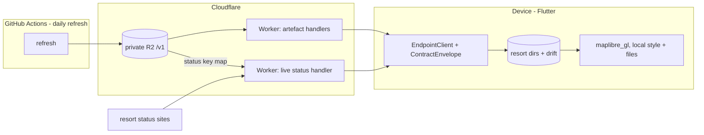

# Architecture

## Overview

The system's shape, where each part runs, its seams and principles. Why each choice was made is in [DECISIONS.md](DECISIONS.md); naming and style are in [CONVENTIONS.md](CONVENTIONS.md).

---

## Core Principles

1. **Compile-Time Correctness**: Use strong typing, Result types, and discriminated unions to catch errors at compile time
2. **Security Boundaries**: Explicit authentication and authorisation layers with clear separation of concerns
3. **Testability**: Dependency injection, interface-based design, and pure functions where possible
4. **Simplicity**: Avoid over-engineering; prefer clear, maintainable code over clever abstractions

---

## System design

Everything the backend serves is either an **enveloped JSON document** or a **binary file** that such a document pins by hash. Reasons for each choice are in [DECISIONS.md](DECISIONS.md).

- **Catalogue**: one per deployment; lists every resort (id, name, country, centre point, current manifest version).
- **Resort manifest**: one per resort, built daily; lists the resort's parts, each with its own `dataVersion`, hash and size. Parts are *data* (runs, lifts, pre-built routing graph, status key map; JSON), *basemap* (vector PMTiles) and *terrain* (elevation PMTiles).
- **Status**: fetched live on request by the Worker, enveloped and stamped with a fetched-at time and the data-part `dataVersion` its key map came from.
- The device saves a resort as one directory holding the manifest and its parts. User state and the index of saved resorts live in SQLite (`drift`).

Only the skeleton parts are built: the artefact handler, `EndpointClient` + `ContractEnvelope`, and a local-file map. The refresh, live status handler, storage and routing are future features.

### Where things run

- The **device** does rendering, routing, storage and location. Location never leaves the device.
- A **Cloudflare Worker** (TypeScript) is the only public door, in front of **private R2**.
- A **GitHub Actions** cron runs the daily refresh: it builds parts and publishes them.

### Seams

- Worker and R2: the key layout, owned by one module (`endpoint/src` artefact layout).
- Worker and resort sites: one adapter per resort behind the status handler.
- App and Worker: HTTP plus the envelope.
- App and map library: a local style pointing at local files.
- Sweep and layers: reports in the results directory.

### Principles

- Worker request handlers serve stored artefacts. The single exception is the status handler, a live adapter that fetches and parses one resort per request. All other processing happens in the daily refresh.
- R2 is never public: no public bucket, no custom domain on the bucket.
- JSON documents are enveloped (`kind`, `schemaVersion`, `dataVersion`); binaries are pinned by hash in a manifest. The app checks versions in one place (`ContractEnvelope`); `/v1/` versions the route layout only.
- R2 parts are immutable and content-addressed; the catalogue and manifests are mutable "latest" keys; parts no manifest has referenced for 7 days are deleted.
- No map style references a remote URL; the app always passes an explicit local style, and map data is loaded from a file on disk.
- One dev config (`tools/dev.env`) is the home for the port, URL, simulator, AVD, JDK version and endpoint timeout; the dev-app command, `--dart-define`, `wrangler dev`, the Patrol run and the sweep all read it.
- The sweep owns "not silently green": a failing test, a layer with zero tests, a missing device or stale results all make it red and name the culprit.
- Failure posture: request paths and developer-run tooling fail fast and visibly. The daily refresh is the one invisible path; F20 must expose data age from outside the job and C3 must alert.

### Repo layout

- `app/`: Flutter app, with Patrol E2E tests in `app/patrol_test/<endpoint-state group>/`.
- `endpoint/`: the Worker and its tests.
- `tools/`: dev config, dev-app command, E2E runner, full sweep (`tools/sweep/`) and the fixture generator.
