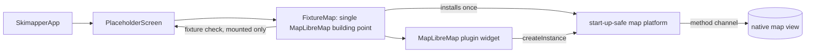

# B1 Map removed before it is ready throws — design

Spec: `specs/B1-map-dispose-before-ready.md`. No UI surface (no sketch). Grilling found no open
technical branch: the plugin's code fixes the cause (below), the E2E entry point (`SkimapperApp`,
not `main()`) fixes where the fix must be reached, and the spec fixes the test layer.

## 1. Reviewer summary

**Cause.** `MapLibreMap.dispose` tears its platform down when no controller exists yet. The default
platform (`MapLibreMethodChannel`) assigns its `late _channel` only in `initPlatform`, which runs once
the native view exists. Removing the map in that window reaches `_channel` unassigned and throws
`LateInitializationError`. A second, smaller fault: `FixtureMap`'s fixture check keeps polling and
reporting after the map has gone.

**Basis (A).** Use the extension point the plugin already provides, `MapLibrePlatform.createInstance`.
The app's map platform gets one more degree of freedom: it knows whether its channel was ever
opened, and if it was not, its teardown has nothing to close. Add a rule, "only a mounted map
reports", to the fixture check that `FixtureMap` already owns. Rejected: B, a patched copy of
`maplibre_gl_platform_interface` vendored through `dependency_overrides`. A and B are one concept
delivered two ways. The non-goals (no upstream PR, no plugin change) keep the space that narrow. B
carries a fork and its licence, must be re-patched on every upgrade, and a later `pub upgrade` can
drop the patch without any error.

**Decisions**

1. **The fix is a start-up-safe map platform** in `lib/map/`, a `MapLibreMethodChannel` subclass.
   - It sets its "opened" flag synchronously on entry to `initPlatform`, before the first await. That
     is the same synchronous step in which the plugin assigns `_channel`.
   - Its `dispose` runs the inherited teardown only when the channel was opened. It catches no
     error.
   - Skipping teardown is sound only because nothing is awaited between constructing the controller
     (which registers callbacks) and assigning the channel, in `onPlatformViewCreated`. The skip also
     bypasses `MapLibrePlatform.dispose`'s `@mustCallSuper` callback clearing, which in that window
     has empty lists to clear.
   - Rejected: setting the flag after the await. Removing the map during `map#waitForMap` would then
     leak the handler and the callbacks without any error. Also rejected: catching
     `LateInitializationError`, which the spec forbids.
2. **The install sits at the map module's single point that builds `MapLibreMap`.** Today that point
   is `FixtureMap`. The install runs before `MapLibreMap`'s state is created. It is set once per
   process, and later calls do nothing. A future map widget reuses that building point and does not
   call the installer itself. The install is therefore reached from `main()`, from every Patrol test
   (they pump `SkimapperApp`) and from the widget tests.
   - Rejected: installing in `main()`, which Patrol never calls, so AC 3 would test nothing.
   - Rejected: installing in `SkimapperApp`, which the widget tests would bypass.
   - Rejected: an architecture test to enforce the rule, which is enforcement nobody asked for.
3. **The fixture check queries and reports only while mounted.** It drops the result of a query
   that was already in flight. If that in-flight query *fails* after removal, the failure is not
   caught and it surfaces.
   - Such a failure is unlikely: native Android answers calls already in flight before it removes
     its handler (`MapLibreMapController.java` dispose), and the Dart-side
     `setMethodCallHandler(null)` stops only inbound calls.
   - If AC 3's CI run shows a post-removal query failure, treat it as a finding to investigate, not
     noise.
   - Rejected: catching query errors after removal, which conflicts with the spec's "other errors
     surface" constraint.
4. **The widget tests fake the native side at the channel boundary.** The fake handles
   `SystemChannels.platform_views` and the plugin's per-map method channel. Like a device, it stops
   answering the per-map channel once the view is disposed. The real `MapLibreMap`, the real
   `MapLibreMethodChannel` and the fix all run.
   - AC 1 runs for both the Android and the iOS target, because `buildView` differs between them.
   - Fallback, if the `platform_views` plumbing proves too much: a fake `MapLibreMethodChannel`
     subclass that overrides only `buildView`. That still gives a true RED against today's code, and
     the fake moves onto the start-up-safe platform at GREEN.
   - Rejected: a fake `MapLibrePlatform`, which would replace the very code that throws.
5. **`FixtureMap` takes an optional basemap-file parameter.** It defaults to today's install, and the
   widget tests pass a ready path. Rejected: faking `path_provider` and doing real file IO under
   `runAsync`, which adds a dev dependency and test machinery for no gain.
6. **The fixture check's deadline reads `clock.now()` from `package:clock`.** `DateTime.now()` does
   not advance under `flutter_test`'s fake time, so with it the deadline branch is never reached.
   `clock` becomes a direct dependency (it is already a transitive one). This changes the mechanism,
   not the behaviour.
   - Rejected: a deadline counted in polls, which would change the wall-clock deadline.
   - Rejected: leaving the deadline branch untested.

**Guiding principles**

- Only the map module touches `MapLibrePlatform.createInstance`. Every `MapLibreMap` is built through
  the module's single building point, so it always runs on the start-up-safe platform.
- Fix the cause and catch nothing.
- Only a mounted map reports, and at most once. Nothing `FixtureMap` started may call back after it
  is gone.
- The plugin and app code under test run for real. Only the native side is faked, and other
  dependencies are passed in rather than faked.

**Risks / blast radius**

- The override applies to every map in the process, which is the intent. Web would lose its
  plugin-registered instance, but the app has no web target.
- The main risk is a plugin upgrade that changes where the channel is opened. That can break the fix
  in two directions, and each is guarded by a test against the real plugin class:
  - The inherited teardown runs on a channel that was never opened and throws. The AC 1 test catches
    this.
  - Teardown is skipped on a channel that is open, which leaks silently. The test that holds
    `map#waitForMap` catches this.

**Technical unknowns**

- How much plumbing `AndroidView`/`UiKitView` creation needs in `flutter_test` with a hand-rolled
  `platform_views` fake. Slice 1 finds out on day one; the fallback is in decision 4.
- Whether this sandbox can dispatch `sweep.yml` (`git fetch` to github.com is blocked). AC 3 may
  need the user to press **Run workflow**.

**Disproportionate complexity.** The spec demands that ACs 1 and 2 reproduce deterministically on
the local machine. That drives most of the cost, through the channel-level fake. Proving the fix on
CI only would remove the fake, but a regression would again surface only on CI. The spec already
rejected that, and there is no other lever.

**Not changing:** the E2E tests, the plugin version, and the map's style, camera, fixture rule and
deadline length. `PlaceholderScreen`'s layout and `main()` do not change either.

**Gate rulings**

- **Basis:** A.
- **Decisions:** 1–6 accepted. Decision 5 was flipped after review from a `path_provider` fake to a
  defaulted parameter. Decision 6 (`clock`) was added after review.
- **Review resolutions:** the architecture lens approved with minor findings, and the design skeptic
  approved once M1–M3 were fixed. Both reviews' findings, the register fixes and the reworded
  testing principle were accepted as a set.

## 2. Basis, then decomposition

**Candidate A (chosen): extend the plugin's platform at its own seam.** It has two concepts:

- The start-up-safe map platform owns teardown in every start-up window.
- `FixtureMap`'s fixture check owns "report once, only while mounted".

How the ACs follow:

- AC 1 follows from the platform: removing the map before `initPlatform` closes nothing.
- Window 3 (the map is created but its style has not loaded) is already handled by the plugin's
  `_disposed` guard.
- AC 2 follows from the check's mounted rule.
- AC 3 follows from both, because Patrol pumps `SkimapperApp`, which builds `FixtureMap`, which
  installs the platform.

*What it makes hard:*

- It depends on a private contract: `_channel` is assigned synchronously on entry to `initPlatform`,
  in the same synchronous step as the controller's construction, and it is closed in `dispose`.
  Nothing in the type system flags an upgrade that changes this. Only the two teardown tests do.
- It sets a process-wide static.
- Its weakest AC is AC 1 staying true over time. A plugin upgrade, or a future map widget that
  bypasses the module's building point, would break it without any error.

**Candidate B: vendor a patched platform interface.** It has one concept: a local copy of
`maplibre_gl_platform_interface` with a `dispose` that is safe on an unopened channel, wired in
through `dependency_overrides`. The fixture-check rule is the same as in A.

AC 1 follows directly, and it covers every map without any install step.

*What it makes hard:*

- Every `maplibre_gl` upgrade means re-diffing and re-patching a package of about 4,800 lines.
- The repo carries third-party code and its licence.
- Its weakest AC is AC 3 staying true over time: a later `pub upgrade` drops the patch without any
  error, unless the override is pinned.

A and B differ in how the fix is delivered, not in kind. The non-goals keep the space that narrow.
The one shape that differs in kind is keeping the map widget alive until its native view exists. It
is rejected because it fights Flutter's ownership of the widget tree.

**Decomposition (A).**

New: the start-up-safe map platform and its once-per-process installer, both in `lib/map/`.

Changed: `FixtureMap`. It installs the platform, takes an optional basemap file, and guards its
fixture check with the mounted rule and a `clock`-based deadline.

**Seams:**

- `createInstance`, which is the new reach into the plugin. The others already exist: the widget,
  the controller query, and the local style that ARCHITECTURE.md names.
- The native channel boundary, where the tests fake.
- `FixtureMap.onFixtureChecked`, which is the only way out of the map module.

## 3. Single-home register

| Business rule | Single home | Paths that consume it |
|---|---|---|
| Removing a map in any start-up window raises no error (new) | start-up-safe map platform, `lib/map/` | Every `MapLibreMap`; today only `FixtureMap`. `FixtureMap` is reached from `main()` → `SkimapperApp` and from all five Patrol tests, which pump `SkimapperApp`: `endpoint_serving/{attribution,endpoint_message,offline_map}_test`, `endpoint_stopped/endpoint_unreachable_test` and `endpoint_malformed/endpoint_not_understood_test`. The new `test/map/` widget tests pump `FixtureMap` directly. |
| Which platform the plugin uses (new consumer of the plugin's static) | map module installer, `lib/map/` | The install call at `FixtureMap`, the module's single `MapLibreMap` building point. `MapLibreMap`'s `createInstance` read is the only reader. |
| Only a mounted map reports the fixture check, at most once (new) | `FixtureMap`'s fixture check | `PlaceholderScreen`'s map line, through `onFixtureChecked`. `offline_map_test` relies on a mounted map still reporting. |
| Fixture feature recognition (existing, unchanged) | `containsFixtureFeature` | `FixtureMap`'s fixture check |
| Render deadline and poll interval (existing; the deadline now reads `clock`) | `FixtureMap` constants | `FixtureMap`'s fixture check |

## 4. Data / schema shape

None.

## 5. Test strategy

**AC 1: removal before the native view exists.**

- Outer test: a widget test in `test/map/` (fast layer).
- It pumps `FixtureMap` with the native view's creation held back, removes it, and expects no error.
- It runs for the Android and the iOS target.
- Against today's code it fails with `LateInitializationError`.

**Removal during `map#waitForMap`.**

- Outer test: a widget test.
- It removes the map while `waitForMap` is held, then checks that the per-map channel's inbound
  handler is gone: an inbound `map#onStyleLoaded` finds no handler.
- This guards the silent-skip direction of decision 1.

**AC 2: removal during the fixture check.**

- Outer test: a widget test.
- It sets up the in-flight window: the view is created, `map#waitForMap` is answered,
  `map#onStyleLoaded` is sent and a query is held in flight.
- It then removes the map and releases the query with a "found" reply, so today's code reports
  straight away and the RED fails for the right reason.
- A second case removes the map and advances fake time past the deadline, which `clock` makes
  reachable.
- Both cases expect no error and no `onFixtureChecked` call.

**AC 3: proof on devices.**

- Outer test: the existing Patrol suite, in one dispatched `sweep.yml` run on the branch.
- It is judged on map-disposal teardown failures only. A post-removal query `PlatformException`
  counts as a failure to investigate.
- The full local sweep (all five layers) must pass too.

There is no database. Every behaviour has a non-unit outer test.

## 5a. Failure posture

- Teardown runs in the foreground. Every error except the one being removed still surfaces
  unchanged.
- A query that fails after removal surfaces too (decision 3).
- The one path that could fail without being seen is a skipped teardown on an open channel. The
  `waitForMap` test guards it.
- Nothing else here is invisible or irreversible.

## 6. Definition delta

No area doc covers the map yet (`docs/definitions/` is empty). The fix restores intended behaviour,
so there is no delta.

At finish:

- `DECISIONS.md` gets a short note under D4: the app installs a start-up-safe map platform, why it
  does, and that it can be removed once the plugin closes an unopened channel safely.
- `ARCHITECTURE.md`'s Seams list gains "App and map library: the platform installed through
  `createInstance`, owned by the map module".

## 7. First slices (indicative)

1. A developer runs `flutter test` and sees a widget test pass that removes the fixture map before
   its native view exists, for the Android target. Against today's code, that test fails with
   `LateInitializationError`.
2. A developer runs `flutter test` and sees the same removal pass for the iOS target. They also see
   that a map removed during `map#waitForMap` leaves no inbound handler behind.
3. A developer runs `flutter test` and sees a widget test pass that removes the map while a fixture
   query is in flight. There is no error and no map-line report, both when the query returns and
   after the deadline.
4. A developer dispatches the branch sweep and sees no map-disposal teardown failure in either E2E
   layer's results.

## Slices

- [x] 1. A developer runs `flutter test` and sees a widget test pass that removes the fixture map before its native view exists, for the Android target (fails with `LateInitializationError` against the old code).
- [x] 2. A developer runs `flutter test` and sees the same removal pass for the iOS target, and sees that a map removed during `map#waitForMap` leaves no inbound handler behind.
- [ ] 3. A developer runs `flutter test` and sees a widget test pass that removes the map while a fixture query is in flight: no error and no map-line report, both when the query returns and after the deadline.
- [ ] 4. A developer dispatches the branch sweep and sees no map-disposal teardown failure in either E2E layer's results.

## Decisions taken during implement

- The `platform_views` fake needed only a held `create` reply for AC 1; decision 4's fallback (a `buildView` override) was not needed.
- The installer is a plain assignment of `StartUpSafeMapPlatform.new` (a canonical constructor tear-off), so repeat calls are no-ops without a "done" flag.

## Resume

- Closed: slices 1–2 (one commit each on this branch). Evidence: `test-results/tdd/B1/`.
- Next: slice 3 — removal while a fixture query is in flight: no error and no `onFixtureChecked`, both when the held query returns "found" and (second case) after the deadline. Needs `package:clock` as a direct dependency (decision 6), and the fake to answer `map#waitForMap`, accept `map#onStyleLoaded` sent inbound, and hold `map#queryRenderedFeatures`.
- Seams: `lib/map/start_up_safe_map_platform.dart` (`StartUpSafeMapPlatform`, `installStartUpSafeMapPlatform`), installed in `_FixtureMapState.initState`; `FixtureMap(basemapFile:)` optional; fake in `app/test/map/fake_native_map.dart` (`holdViewCreation`, `waitForMapRequested`, `sendToMap`).
- Slices 2's tests guard an existing fix, so their RED was taken against the fix removed / the rejected variant, then restored (logged).
- `flutter` must run outside the sandbox (its cache is not writable inside).
