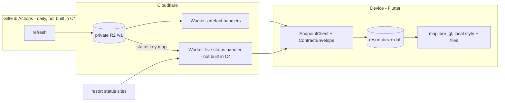

# C4 — Initial technical decisions and walking skeleton: design

Spec: `specs/C4-initial-technical-decisions.md` · Gate closed 2026-10-18.

## 1. Reviewer summary

**Basis (A, chosen).** Everything the backend serves is either an **enveloped JSON document** or a **binary file** that such a document pins by hash.

- **Catalogue.** One per deployment. It lists every resort: id, name, country, centre point, and the current manifest version. That is enough for F1 (browse) and F2 (sort by distance on the device).
- **Resort manifest.** One per resort, built daily. It lists the resort's **parts**, each with its own `dataVersion`, hash and size:
  - *data*: runs and lifts, the routing graph, and the status key map that matches the resort's own lift names to our ids (JSON);
  - *basemap*: vector PMTiles;
  - *terrain*: elevation PMTiles used for hill shading.
- **Status.** Fetched **live on request** by the Worker. It is enveloped and stamped with a fetched-at time and the data-part `dataVersion` its key map came from.

The device saves a resort as one directory holding the manifest and its parts. F17 (progress), F18 (size and removal) and F19 (per-part updates) all read the manifest. In the skeleton, the fetched message stands in for a JSON document and the bundled tile stands in for a basemap part.

*Rejected bases:*
- *B: the same concepts, but parts served from a public R2 bucket or CDN.* This breaks C1's rule that data is reachable only through the service.
- *C: a service per data kind.* Tile endpoints, MapLibre offline regions, and the graph built on the device. It means thousands of Worker requests per resort, F18 can't measure or remove a single resort, and the run/lift join would live in two places.

**Decisions.**

- **G1 Flutter** (ruled in grilling).
  - Rejected: React Native with Expo, which has the more mature MapLibre binding.
  - Rejected: KMP with Compose, which has the youngest map binding and the heaviest iOS tooling.
  - Consequence: offline maps become the riskiest choice. See D4 and slice 1.
- **G2 A thin edge endpoint over stored artefacts** (grilling).
  - Rejected: a server with a database (free tiers sleep or pause).
  - Rejected: purely static hosting (C1 and C2 couldn't be enforced).
- **G3 Repo starts private** (grilling). It has 2,000 Actions minutes a month, and macOS minutes count ×10. Go public if minutes run out. A public repo's scheduled workflows are disabled after 60 days without activity.
- **G4 The sweep boots the named simulator and AVD itself** (grilling).

1. **Architecture and hosting.**
   - The **device** does rendering, routing, storage and location. Location never leaves the device.
   - A **Cloudflare Worker** (TypeScript) is the only public door, in front of **private R2**.
   - A **GitHub Actions** cron runs the daily refresh: it builds parts and publishes them.
   - **No status cron.** Status is fetched live (D3).
   - Free-tier fit is **unverified until the first deploy**: Workers allow 100k requests a day and 10 ms of CPU per request; R2 allows 10 GB-month, 1M writes and 10M reads a month, with free egress; Actions minutes are shared with C5.
   - Rejected:
     - Supabase (pauses when idle).
     - Render (sleeps after 15 minutes and wakes in about a minute; bandwidth is 5 GB).
     - Fly.io and Railway (trial only).
     - Firebase (functions need a paid plan).
     - **Oracle Always Free VM**: always on with no CPU cap, but we'd own patching, TLS and uptime, and Oracle cut the free allowance without notice in June 2026.
     - **Vercel Hobby for everything**: Blob gives 1 GB of storage, 10 GB of transfer and 2,000 uploads a month, with a 30-day lockout on overage. That doesn't fit 5–25 MB map parts, and Hobby is non-commercial only.
2. **Resort data comes from OpenSkiMap's exports.**
   - The licence of the exports, especially the ski-area fields derived from Skimap.org, is **unverified**. **F1 must confirm it before shipping.**
   - Fallback: raw OSM (a Geofabrik extract processed with osmium, grouped by `landuse=winter_sports`).
   - Rejected: Skimap.org on its own (no open licence for geometry).
   - **ODbL obligations:** the app credits "© OpenStreetMap contributors". The derived database is offered as a periodic dump on request. C1 limits *bulk serving*, not availability.
3. **Live status: fetched in the Worker for each request.** `GET /v1/status/{resort}` works like this:
   1. Serve a cached copy if it is younger than about 60 s.
   2. Otherwise fetch the resort's own source page and parse it with that resort's adapter (`HTMLRewriter`).
   3. Map the resort's lift and run names to our ids using the status key map from R2.
   4. Return the result enveloped and stamped.
   - **Caching:** best effort, in memory, until a custom domain exists. Cloudflare's Cache API needs a custom domain. KV's free tier allows only 1,000 writes a day.
   - **Adapters:** ported from Liftie's open-source parsers (BSD-3). **Liftie covers lifts only, and that gap is accepted.** Runs show as "unknown", which F6 hides, unless we write our own adapter.
   - **Fallback order:**
     1. Workers Paid ($5 a month).
     2. A status-only Vercel Hobby function, with the Worker forwarding `/v1/status/*` to it.
     3. An Oracle VM.
   - **Fallback triggers:** F6 measures more than about 5 ms of CPU per resort, or resort sites block Cloudflare.
   - **Deferred to F6, A+:** keep a last-good copy in R2, written only when it changes.
   - Rejected: the app fetching resort sites directly (fixing an adapter would need an app release, which breaks F20; every user hits the resort site; C1 and C2 are bypassed).
   - Rejected: a scheduled feed refreshed by cron (not live on request).
   - Rejected: calling liftie.info (no terms, and it reportedly blocks servers).
   - Rejected: paid feeds.
4. **Offline map and terrain.**
   - The map library is **`maplibre_gl`** (the MapLibre organisation's Flutter plugin, v0.27, with PMTiles and offline support on both platforms).
   - The refresh cuts a basemap from **Protomaps** with `pmtiles extract --bbox` (ODbL).
   - The refresh cuts terrain from **Mapterhorn** (Terrarium WebP PMTiles; mixed open sources, credited in-app).
   - The device loads both from **local files**, with native hillshade.
   - Expected size is about 5–25 MB per resort. F17 measures it.
   - Rejected: MapLibre offline regions from a third-party host (the host's terms, and no per-resort sizing).
   - Rejected: AWS Terrain Tiles (XYZ PNGs we would have to repack).
   - **Fallback order if a platform fails:**
     1. `mbtiles://` from a file.
     2. The `maplibre` package (josxha).
     3. `flutter_map`.
     4. If all of those fail, **STOP and reopen G1**.
5. **On-device storage.** Each saved resort is **a directory holding its manifest and parts**. User state and the index of saved resorts go in **SQLite via `drift`**.
   - Rejected: `sqflite` used directly.
   - Rejected: Isar and Hive.
6. **Routing: our own Dijkstra/A\* in Dart, over a graph the refresh pre-builds** and ships in the data part.
   - Edges carry kind, difficulty, status key and time.
   - F12–F14 filter or weight edges when a route is requested.
   - Rejected: building the graph on the device.
   - Rejected: GraphHopper and Valhalla.
7. **Test layers.**
   - **Fast:** `flutter test`, plus Vitest for the Worker.
   - **Slow:** Worker integration tests (`@cloudflare/vitest-pool-workers` with Miniflare R2), plus the sweep self-test.
   - **E2E: Patrol** (ruled at the gate). Tests are written in Dart, find Flutter widgets by key or text, and drive native UI on both platforms, including Android's Wi-Fi and cellular toggles. Results come out as each platform's native test report.
   - Rejected: Maestro (YAML, black box, depends on semantics identifiers). **It is the fallback** if Patrol's native iOS runner can't be made to work.
   - Rejected: bare `integration_test` (can't drive native UI, such as F2's permission dialog).
8. **Data-contract versioning.**
   - Every **JSON** document carries an envelope of `kind`, `schemaVersion` (per kind) and `dataVersion`.
   - Binaries are pinned by hash in the manifest.
   - `/v1/` versions the route layout only.
   - A breaking change to one kind bumps that kind's `schemaVersion`, and the endpoint keeps publishing the old version until old apps age out.
   - The app checks the version in one place. An unknown version shows a visible "update the app" message, and the saved copy is kept.
   - Rejected: no versioning until F19 (copies saved before then could only be deleted).
   - Rejected: ETags only (they don't survive into saved copies).
9. **Placeholder screen.** One column:
   - App name.
   - Endpoint line, showing exactly one of: *loading*, *the message*, *"service could not be reached"* (timeout or refused), or *"service response not understood"* (non-2xx, bad envelope, or unknown version). Nothing but the message looks like success.
   - A fixed-height map area.
   - A map line: "map: fixture feature found" or "map: fixture not rendered".
   - An attribution line.

   **The HTML sketch is waived** (gate).

**Guiding principles.**
- **Worker request handlers serve stored artefacts. The single exception is the status handler,** a live adapter that fetches and parses one resort per request. All other processing happens in the daily refresh.
- **R2 is never public.** No public bucket and no custom domain on the bucket; everything goes through the Worker.
- **JSON documents are enveloped; binaries are pinned by hash in a manifest.** The app checks versions in one place.
- **R2 layout:**
  - Parts are immutable and content-addressed, so an unchanged terrain is never re-uploaded.
  - The catalogue and manifests are mutable "latest" keys.
  - The refresh deletes parts that no manifest has referenced for 7 days.
- **No map style references a remote URL, and the app always passes an explicit local style.**
- **The device loads map data from a file on disk.** The skeleton copies its fixture there first.
- **One dev config is the home for** the port, URL, simulator, AVD and endpoint timeout. The dev-app command, `--dart-define`, `wrangler dev`, the Patrol run and the sweep all read it. Android reaches the host through `adb reverse`.
- **The sweep owns "not silently green"** and clears the results directory every run.

**AC1 check matrix.** ✓ satisfies · ? unverified (and which feature verifies it) · — not affected.

| | 1 codebase | offline-first | routing on device | location on device | open daily sources | free tier | offline licence | storage/resort | routing perf |
|---|---|---|---|---|---|---|---|---|---|
| G1 Flutter | ✓ | ✓ via D4/D5 | ✓ Dart | ✓ | — | ✓ | ✓ BSD | — | ✓ AOT |
| G2/D1 Worker+R2+Actions | — | ✓ saved whole | — | ✓ never sent | ✓ daily | ? first deploy | — | ✓ 10 GB ≈ 400 resorts | — |
| D2 OpenSkiMap | — | ✓ | ✓ | — | ✓ | ✓ | ? F1 | ✓ small | — |
| D3 live status in Worker | — | ✓ status optional offline | ✓ edge filter | ✓ | ✓ live | ? F6 CPU per resort | ? per-site terms (F6) | ✓ none stored | — |
| D4 maplibre_gl+Protomaps+Mapterhorn | ✓ | ✓ local files | — | — | ✓ | ✓ no tile host | ✓ ODbL, open DEMs | ? 5–25 MB (F17) | — |
| D5 dirs + drift | ✓ | ✓ | ✓ | ✓ | — | — | — | ✓ per-dir | — |
| D6 Dart Dijkstra | ✓ | ✓ | ✓ | ✓ | — | — | — | ✓ ≪ 1 MB | ? ms (F11) |
| D7 Patrol | ✓ one suite | — | — | — | — | ✓ OSS | — | — | — |
| D8 envelope | — | ✓ updatable copies | — | — | ✓ | — | — | — | — |

**Risks and unknowns.**
- **Can `maplibre_gl` render a local-file PMTiles fixture on both platforms?** Slice 1 answers this, with the D4 fallbacks and a STOP if they all fail.
- **Patrol's native runner setup on iOS** (the `RunnerUITests` target). Slice 1 tests it, with Maestro as the fallback.
- **Free-tier figures, D2's licence, and D3's per-resort CPU and coverage** are all unverified. Each names the feature that verifies it.
- **Resort sites blocking Cloudflare** is now on the live status path. It triggers the D3 fallback.
- **On a cache miss, status latency is the resort site's latency**, roughly 0.3–2 s.
- **Status/id drift:** status is stamped with the data `dataVersion`, and the app hides it on a mismatch.

**Disproportionate complexity.** E2E on both platforms means two device boots plus `adb reverse`. That lever was already declined in the spec. Otherwise none.

**Not changing.** No area docs, deploy, CI, auth, monitoring, real data, ingestion, routing or storage code. D2–D6 are recorded only.

**Decision count.** 9 decisions plus 4 settled in grilling, above the usual ~7. That's because AC1 *is* a list of ten decisions, so this isn't a sign the feature should be split (accepted at the gate).

**Questions the gate ruled on (2026-10-18).**
- Basis A.
- D1 agreed, amended by D3: no status cron; Oracle VM and Vercel-for-everything added as rejected alternatives; status fallback order recorded.
- D2 (a), OpenSkiMap; F1 confirms the licence.
- **D3 changed**: status is **live on request**. The user asked about a small server and about Vercel, then chose Worker live fetch with a ~60 s cache, A+ deferred to F6, and the fallback order Workers Paid → Vercel status function → Oracle VM. Liftie's lift-only gap is accepted.
- D4, D5 and D6 agreed.
- **D7 changed**: **Patrol instead of Maestro**, with Maestro as the fallback.
- D8 and D9 agreed.
- Principles agreed, with the status-handler exception.
- UI sketch waived.
- ODbL dump-on-request reading agreed.
- Decision count accepted, no split.

## 2. Basis, then decomposition

**A (chosen): envelope + catalogue + manifest of parts + live status.**
- **What each concept owns:**
  - The catalogue owns which resorts exist and where they are.
  - The manifest owns one resort's composition and each part's version and size.
  - Parts own bytes.
  - The live status handler owns turning one resort's source into stamped, id-keyed status.
- **How the ACs fall out:**
  - F16/F17 save the manifest and parts.
  - F18 is a directory's size and its deletion.
  - F19 diffs part versions.
  - F20: a failed resort refresh leaves its old manifest in place.
  - C1/C2 are guards in the one Worker.
  - Status is live on request.
- **What it makes hard:**
  - **F6/F14 correctness depends on the status key map** (resort names → ids) built by the refresh, and on ids staying stable. A mismatch hides status rather than showing wrong status.
  - **Live status ties freshness to the resort sites' uptime and their tolerance of Cloudflare**, which the D3 fallbacks cover.

**B** (public delivery of parts) and **C** (a service per data kind) were rejected for the reasons in § 1.

**Seams:**
- **Worker ↔ R2:** the key layout, which has one owning module.
- **Worker ↔ resort sites:** one adapter per resort, behind the status handler.
- **App ↔ Worker:** HTTP plus the envelope.
- **App ↔ map library:** a local style pointing at local files.
- **Sweep ↔ layers:** reports in the results directory.

E2E tests hang off App ↔ Worker; integration tests hang off Worker ↔ R2.

**Repo layout:**
- `app/`: Flutter, including Patrol tests under `app/patrol_test/`.
- `endpoint/`: the Worker.
- `tools/`: dev config, the dev-app command and the sweep.

### 2a. UI sketch

Waived at the gate. D9 is the record of the screen.

## 3. Single-home register

| Business rule | Single home | Paths that consume it |
|---|---|---|
| Envelope compatibility: accepted `schemaVersion` per kind; an unknown version is a visible error and the saved copy is kept | app `ContractEnvelope` | skeleton message fetch; later catalogue (F1), manifest/parts (F16/F17), update check (F19), live status (F6) |
| Endpoint outcome: reached / unreachable (timeout or refused) / not understood | app `EndpointClient` (timeout comes from the dev config) | placeholder screen; later every screen that fetches |
| R2 key layout, immutable parts vs mutable latest keys, retention | `endpoint/` artefact-layout module | Worker artefact handlers; test seeding of R2; status handler (reads the key map); later refresh publish and GC (F20) |
| Dev config: port, URL, simulator, AVD, timeout | `tools/` dev config | dev-app command, `--dart-define`, `wrangler dev`, Patrol run, sweep |
| No remote URL in map styles; always an explicit local style | local style asset + style-check test | skeleton map; later F5 and F17 |
| Status key map (resort names → ids), and status stamped with the data `dataVersion` | built by the refresh into the data part (F20); the app's status reader hides status on a mismatch | Worker live status handler (F6), map status (F6), routing around closures (F14) |
| Status freshness: cached ≤ ~60 s, then fetched live | Worker status handler's cache | every app status request (F6, F14) |
| Per-resort source parsing | one adapter per resort in `endpoint/`, behind the status handler (moves with the handler if a D3 fallback is used) | status handler only |
| Sweep is red on a failing test, a layer with zero tests or a missing device, and names the culprit; results dir cleared each run | `tools/` sweep | full sweep; later CI (C5) |
| Attribution text (OSM, OpenSkiMap, Protomaps, Mapterhorn sources) | app attribution widget | skeleton screen; later F5 |

## 4. Data / schema shape

- **No database server.**
- **R2:** content-addressed immutable parts, mutable latest JSON keys, and 7-day garbage collection of unreferenced parts. 10 GB holds about 400 resorts at 25 MB each. Status is not stored (unless F6 adopts A+, writing on change only).
- **Skeleton:** stores one message artefact. On the device it writes only the copied fixture file.
- **`drift`** starts at F1 or F16 with migration 1, so there is no backfill risk.

## 5. Test strategy (per behaviour)

- **The message is shown (iOS and Android).**
  - Outer test: E2E (Patrol).
  - The sweep or E2E runner seeds local R2 and starts `wrangler dev` before `patrol test`.
- **"Not understood" is shown for a malformed response.** E2E on one platform, with a malformed artefact seeded.
- **The fixture tile renders offline (iOS and Android).**
  - E2E asserts **"map: fixture feature found"**. The app queries a known fixture property by source layer, which no remote style could produce.
  - **Android disables Wi-Fi and cellular through Patrol's native API.** `adb reverse` still reaches the host.
  - iOS relies on the fixture-identity check plus the fast style-check test.
- **Unreachable is shown within seconds (both platforms).** E2E with no endpoint running.
- **The Worker serves enveloped artefacts from private R2 under `/v1/`.** Integration test against Miniflare R2.
- **The sweep can't go silently green.** A sweep self-test against stub layers (failing, zero tests, missing device, stale results) asserts a red exit that names the culprit.

### 5a. Failure posture

The skeleton is all request-path or developer-run, so it fails fast and visibly. Other failures are accepted.

Live status is a request path too, so its failures surface on screen ("status unavailable", hidden by F6).

Recorded forward: the **daily refresh is the one invisible path**. Running out of Actions minutes stops it without a failure email. F20 must expose data age from outside the job, and C3 must raise alerts. Until then, the catalogue's `dataVersion` date is the check.

## 6. Definition delta

- **No area doc changes.**
- At finish:
  - **ARCHITECTURE.md** gains the basis, seams and principles.
  - **DECISIONS.md** gains G1–G4 and D1–D9, with rejected alternatives, fallbacks and the AC1 matrix.
  - **PIPELINE.md** gets real commands (fast: `flutter test` + Vitest; slow: Worker integration + sweep self-test; E2E: `patrol test` per platform; sweep; results dir; dev app taking a platform argument).
  - A **`.gitignore`** is added (covering `.idea/` and build outputs).

## 7. First slices (indicative)

1. **Map spike.** *The developer runs the dev-app command for iOS and then Android (Android with networking off), and sees "map: fixture feature found" from the fixture tile, loaded from a file on disk by `maplibre_gl`. The Patrol test passes on both.* This proves Flutter, the plugin, Patrol's native runners, the dev config and device booting. STOP if the D4 fallbacks are exhausted. Switch to Maestro if Patrol's iOS runner can't be made to work.
2. *The developer starts the local endpoint with a message seeded by the test, launches the app on each platform, and sees that message.*
3. *The developer launches the app with the endpoint stopped and sees "service could not be reached" within seconds. With a malformed artefact seeded, the developer sees "service response not understood".*
4. *The developer runs the full sweep with one layer broken (a failing test, a layer with no tests, a missing AVD, or stale results) and sees it exit red, naming the culprit. With nothing broken, it is green.*

## Slices

- [x] 1. **Map spike.** The developer runs the app on iOS and Android (Android with networking off) and sees "map: fixture feature found" from a fixture tile loaded from a file on disk by `maplibre_gl`; the Patrol test passes on both.
- [x] 2. The developer starts the local endpoint with a message seeded by the test, launches the app on each platform, and sees that message.
- [x] 3. The developer launches the app with the endpoint stopped and sees "service could not be reached" within seconds; with a malformed artefact seeded, sees "service response not understood".
- [ ] 4. The developer opens the app and sees the attribution line crediting OpenStreetMap contributors, OpenSkiMap, Protomaps and Mapterhorn's sources.
- [ ] 5. The developer runs the full sweep with one layer broken (a failing test, a layer with no tests, a missing AVD, or stale results) and sees it exit red, naming the culprit; with nothing broken, it is green.

## Decisions taken during implement

- **iOS uses Swift Package Manager, not CocoaPods.** Flutter 3.47 creates SPM projects by default; `maplibre_gl` 0.27.1 and `patrol` 4.10 both ship SPM packages. The Patrol `RunnerUITests` target was added with the `xcodeproj` gem (the scriptable equivalent of Patrol's Xcode GUI steps) and links `FlutterGeneratedPluginSwiftPackage`.
- **JDK 25 (Corretto 25 LTS) for Android builds**, chosen by the user as the newest JDK Gradle 9.3.1 supports. The dev config holds `ANDROID_JDK_VERSION`; `tools/lib/common.sh` resolves `JAVA_HOME` from it so a stale shell `JAVA_HOME` can't break builds.
- **Dev config is a sourceable `tools/dev.env`** (bash scripts read it directly; values reach the app via `--dart-define`).
- **Results dir is `test-results/` (gitignored); the sweep will clear only `test-results/sweep/`**, so TDD evidence and the demo pack under the same dir survive a sweep (user agreed).
- **The fixture tile is generated by `tools/fixtures/make_fixture_pmtiles.py`** (one z0 MVT tile, gzip, PMTiles v3) and committed; the map camera sits at zoom 8 so the fixture polygon fills the map and a 20×20 query rect at the origin hits it in both Android pixels and iOS points.
- **Worker tests use `@cloudflare/vitest-plugin`**, the renamed `@cloudflare/vitest-pool-workers` (deprecated; its last release needs Vitest 4). Same Miniflare R2 integration, same layer.
- **E2E tests are grouped by the endpoint state they need**: `app/patrol_test/<group>/` (`endpoint_serving`, later `endpoint_stopped` / `endpoint_malformed`); `tools/e2e` prepares each group's endpoint, then runs Patrol on it. The runner seeds a fresh message per run and hands the same string to the test (`E2E_SEEDED_MESSAGE`), which is how "a message chosen by the test" is met while seeding stays on the host.
- **Local seeding goes through `endpoint/scripts/seed-local.ts`** (run by Node's native TypeScript support), which imports the artefact-layout module, so the R2 key layout keeps one home.
- **The "not understood" E2E runs on both platforms**, not one: the runner treats every group the same and the extra iOS run costs about a minute.
- **"Not understood" is signalled by `FormatException`**: `openEnvelope` throws it for a wrong kind, an unknown `schemaVersion` or a non-envelope, the same exception `jsonDecode` throws, and `EndpointClient` maps it (and any non-2xx) to `NotUnderstood`; refused/failed connections and the dev-config timeout map to `Unreachable`.
- **iOS simulator is "iPhone 17"** — the newest unique iPhone name on this machine ("iPhone 18 Pro" exists twice, so a name lookup would be ambiguous).

## Resume

Slices 1–3 closed (map spike; endpoint message; unreachable / not understood — all four E2E scenarios green on iOS and Android via `tools/e2e <platform>`). Next: slice 4 — *the developer opens the app and sees the attribution line* (app attribution widget = single home; widget test). Then slice 5 — the sweep (`tools/sweep`): runs fast (flutter test + endpoint `test:unit`), slow (endpoint `test:integration` + sweep self-test), E2E per platform; red on a failing test, a zero-test layer or a missing device, naming layer + platform; clears only `test-results/sweep/`. `endpoint/test/unit/` is still empty, so the sweep's zero-test rule will flag it — slice 5 needs a real Worker unit test there or a decision. Known: an iOS Patrol run with a failing test takes ~10 min to exit; a `FutureBuilder` error (e.g. a missing `ENDPOINT_URL` define) would still show "endpoint: loading" — candidate for finish review. Device commands and `flutter` run outside the sandbox; npm needs `npm_config_cache=$TMPDIR/npm-cache`.
