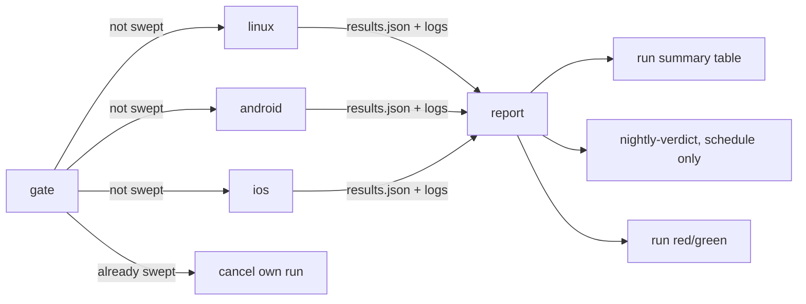

# C5 Continuous integration — design

## 1. Reviewer summary

**Basis.** CI is a set of thin GitHub workflows on top of the **existing sweep**. The sweep gains one
degree of freedom (run a chosen subset of its layers) and one output (a per-layer verdict file). A
small **report** step in `tools/sweep/` combines verdict files from several jobs against the layers
it expected, so a layer that never ran is red. *Rejected:* a workflow-native basis where GitHub job
conclusions are the verdicts. It would restate the layer list and the green rule in YAML, it can't
see a layer that ran zero tests, and only real runs could test it.

**Runner facts (confirmed).**
- Standard private-repo Linux runners (2 vCPU, 8 GB) support KVM-accelerated emulators.
- arm64 macOS runners cannot nest virtualisation, so Android runs on Linux and iOS on macOS, as the
  spec defaults.

**Decisions**
1. **Layer switch** `tools/full-sweep --layers <id,…>`.
   - The ids are `app`, `endpoint`, `self-test`, `e2e-ios` and `e2e-android`, owned by `sweepLayers`.
   - The id is a layer's identity. Display labels (`e2e (ios)`, `sweep self-test`) are derived from
     it, so local output is unchanged.
   - No switch = all five, in today's order.
   - *Rejected:* named presets, a second vocabulary.
2. **Sweep topology:** a `gate` job, then three parallel jobs (`linux`: app, endpoint, self-test;
   `android`: Linux KVM; `ios`: macOS), then a `report` job. *Rejected:* fast layers and Android on
   one 8 GB runner. That saves little at ×1 billing and squeezes Gradle and the emulator together.
3. **Verdicts cross jobs as files.**
   - Each sweep also writes `test-results/sweep/results.json`, uploaded with the logs.
   - `report` combines them against the expected ids and writes the per-layer table to the run
     summary. It fails the run unless every expected layer is green. A missing layer is red, with
     "no result (job did not run)" as its reason.
   - `report` and `runSweep` share **one run-verdict predicate**.
   - *Rejected:* job conclusions, which can't name the layers of a job that never started.
4. **Skip rule.**
   - **Writing the marker:** `report` runs only when the run is **not cancelled** and `gate` decided
     to sweep. It uploads a `nightly-verdict` marker (90-day retention) only for a `schedule` run
     where at least one layer has a **real** verdict from a `results.json`. Red rows filled in for
     missing jobs don't count. The marker is uploaded *before* `report` exits red.
   - **Checking it:** `gate` looks for the marker on earlier `schedule` runs for the head SHA.
     - If it finds one, `gate` **cancels its own run** (grey). The summary names the run that swept
       the commit.
     - If it finds none, the summary says "no marker among N earlier scheduled runs on <sha>", so a
       broken marker path is visible before it burns minutes.
   - The predicate is a pure function in `tools/sweep/`. `gate` gets `actions: write` plus
     `contents: read`; every other job gets `contents: read` only.
   - *Rejected:*
     - a green "skipped" run, which breaks the AC;
     - a cache-key marker, which is evicted after 7 idle days, so the sweep re-runs weekly.
5. **Dependency caching, keyed on dependency inputs, never on build outputs.**
   - **Cached, with their keys:** pub (`pubspec.lock`); Gradle caches and wrapper
     (`gradle-wrapper.properties` and the Gradle build files); npm (`package-lock.json`); the Flutter
     SDK (the pinned version); the Android system image (`ANDROID_AVD_API`); iOS SPM package
     checkouts (`Package.resolved`).
   - **Not cached:** DerivedData, Gradle build outputs and `app/build`. A restored build would mean
     the night proved an incremental build rather than a clean one.
   - Only trunk nightly and manual runs save caches. Pushes only restore them.
   - The manual sweep's `cold` input bypasses every restore. The first nightly is naturally cold.
   - Stage 2's acceptance records billed minutes for one cold and one warm nightly.
   - *Rejected:* caching DerivedData (most ×10 minutes saved, but loses the clean-build proof).
6. **Flutter is pinned to an exact version** in `app/pubspec.yaml` `environment.flutter`, which CI's
   Flutter setup reads.
7. **Linux portability with no CI-only branches in `tools/`.**
   - JDK resolution moves to the Android paths only (`e2e android`, `dev-app android`).
     - macOS uses `java_home` as today.
     - Elsewhere it trusts `JAVA_HOME` and fails fast if its major version ≠ `ANDROID_JDK_VERSION`.
   - A new dev.env value, `ANDROID_EMULATOR_FLAGS`, is empty locally. CI overrides it through the
     environment for a headless emulator.
   - This updates DECISIONS.md's build-time JDK entry.
   - *Rejected:* `if CI` branches inside `tools/`.

**Guiding principles**
- Workflows contain only `tools/full-sweep --layers …`, `node tools/sweep/report.ts`, and runner
  preparation (toolchains, caches, device creation). They never contain a test command or a green
  rule. A self-test ratchet rejects literal `flutter test`, `vitest` and `patrol` invocations in
  `.github/workflows/`.
- Device prep sources `tools/dev.env` and **creates** the devices it names, but never boots them.
  Booting, and boot failure, stay in the sweep (G4).
  - Prep failures don't stop the sweep step (`!cancelled()`), so the sweep's own boot check names
    the device.
- CI overrides dev.env values only through the environment.
- "Green" is decided only by `whyRed` (per layer) and the shared run-verdict predicate (per run).
- The local sweep's output and exit rule are unchanged. New outputs are additional files.
- Third-party actions are pinned by SHA.
- **Concurrency.**
  - Push: one group per branch, `cancel-in-progress`.
  - Sweep: one group per branch, no cancel. GitHub keeps one pending run per group, so a newer
    queued sweep replaces a pending one. That's accepted. Pushes never cancel a sweep.

**Risks / blast radius.**
- The `tools/lib` changes reach local `e2e` and `dev-app`. The unchanged-local-sweep AC and the
  local full sweep guard them.
- The Android job is tight on 8 GB RAM and ~14 GB disk.

**Unknowns,** each surfaced in the slice that builds its platform:
- whether AVD creation for `Pixel_9_Pro_XL_-_Android_15` works with headless emulator flags;
- whether the `macos-26`/`xcode-27` image has an "iPhone 17" device type and runtime;
- the real cold and warm minutes.

**Disproportionate complexity.** The skip rule (marker, API query, self-cancelling `gate`) exists only
because of the private-repo budget. Going public, already the spec's fallback, removes it. There is no
new lever.

**Not changing:** the E2E tests; the local sweep summary and exit rule; pipeline skills; branch
protection (none); deployment (none).

**Gate rulings**

Grilling round 1:
- self-cancel, with `actions: write` on `gate` only;
- `--layers` ids;
- dependency caching in scope;
- Flutter pinned in the pubspec.

Design gate:
- basis A;
- decisions 1–7 as written, with build outputs kept out of the cache;
- review fixes R1–R4 accepted:
  - R1: `report` runs only on non-cancelled sweeping runs, with the marker rule;
  - R2: `withhold_job` input and a real cancelled-then-resweep check;
  - R3: prep failures don't stop the sweep;
  - R4: homes for the expected set and toolchain versions;
- minors folded in;
- a queued manual run replacing a pending nightly accepted.

## 2. Basis and decomposition

**Candidate A (chosen): extend the sweep.** The concepts:
- **Layer** (existing; gains an id).
- **Selection** (ids to run; default all).
- **Verdict file** (per layer: id, label, verdict, reason).
- **Report** (expected ids + verdict files → summary table, run verdict, marker).
- **Skip predicate** (earlier scheduled runs → swept or not).

How each AC falls out:
- Push = one Linux job with `--layers $FAST_LAYERS`, followed by `report --expect $FAST_LAYERS`.
- Failing layer named = the report table plus the attached logs.
- Job never started = an expected id with no verdict is red.
- Device failure = the sweep's existing `fail` line becomes the verdict's reason.
- Docs-only = `paths-ignore`.
- Supersede and sweep independence = separate per-workflow concurrency groups.
- Cancelled, never-started or verdict-less nightlies leave no marker, so the next night sweeps.
- Manual runs never write the marker.

*What it makes hard:* `tools/sweep/` learns a little about GitHub (the step-summary markdown, kept
inside `report.ts`). Its weakest ACs are the cancel and never-started semantics, which rest on the
`report` condition and the marker rule in decision 4. "Job never starts is red" also depends on
`report` itself starting. If it doesn't, only GitHub's own run error shows.

**Candidate B: workflow-native.**
- One job per layer, with job conclusions combined in YAML.
- It needs fewer `tools/` changes.
- But the layer list and the green rule are restated in YAML, "zero tests" is invisible across
  jobs, and only real runs can test it.

**Seams:**
- `sweepLayers`: the only list of layers.
- `results.json`: the only verdict format.
- The run-verdict predicate: the only run-level green rule, shared by `runSweep` and `report`.
- The skip predicate: pure, fed by a thin `gh api` call in `gate`.
- `tools/dev.env`: the only device, JDK and CLI-version values.

UI sketch: none. There is no app change, and the surfaces are GitHub's own.

## 3. Single-home register

| Business rule | Single home | Paths that consume it |
|---|---|---|
| The sweep's layers, ids, labels, order | `sweepLayers` (`tools/sweep/layers.ts`) | local `tools/full-sweep`; `--layers` parsing; push job; `linux`/`android`/`ios` jobs; `report`'s default expected set; `sweep.test.ts`; PIPELINE.md full-sweep row; README.md layer list |
| A layer is red if it exits non-zero or runs zero tests | `whyRed` (`tools/sweep/sweep.ts`) | every sweep, local and CI |
| A run is green only if every expected layer is green; missing = red | run-verdict predicate (`tools/sweep/`) | `runSweep` (local `ok`); `report` in the push job and the sweep's `report` job |
| A scheduled run reached a verdict → write marker | `report` | sweep `report` job; read by the skip predicate |
| Nightly skip: an earlier `schedule` run on this SHA left a marker | skip predicate (`tools/sweep/`) | `gate` job only |
| Fast checks = `app,endpoint,self-test` | `FAST_LAYERS` env in the push workflow | push job's `--layers` and `report --expect`; PIPELINE.md CI row points to it |
| Device names, AVD API level and device profile, emulator flags | `tools/dev.env` (`IOS_SIMULATOR`, `ANDROID_AVD`, `ANDROID_AVD_API`, `ANDROID_AVD_DEVICE`, `ANDROID_EMULATOR_FLAGS`) | `tools/lib/devices.sh` (via `tools/e2e`, `tools/dev-app`); CI device prep (sources it); system-image cache key; CI env overrides; CONVENTIONS.md dev.env convention |
| JDK version and resolution | `ANDROID_JDK_VERSION` in dev.env; resolution in `tools/lib/common.sh` (Android paths) | `tools/e2e android`; `tools/dev-app android`; CI JDK setup |
| Endpoint values reaching the app | dev.env → `endpoint_dart_defines` | `tools/e2e`; `tools/dev-app`; `app/lib/endpoint/dev_endpoint.dart` (unchanged) |
| Flutter version | `app/pubspec.yaml` `environment.flutter` (exact) | Flutter setup in every CI job; Flutter SDK cache key; local `pub get` |
| Node version | root `.nvmrc` | setup-node in every CI job |
| Patrol CLI version | `PATROL_CLI_VERSION` in dev.env | CI Patrol install (`ios`, `android` jobs) |
| Xcode image | `ios` job's `runs-on` label | `ios` job only (CI-only fact) |
| Docs-only push | push workflow `paths-ignore` | push workflow only |

## 4. Data shape

No database.
- `results.json`: one entry per layer that ran (id, label, verdict, reason).
- Artifacts:
  - `sweep-<job>` (logs and results, 14-day retention, inside the 500 MB private-repo storage);
  - `nightly-verdict` (bytes, 90 days). A trunk unchanged for longer is re-swept once, which is
    accepted.
- Caches: within the 10 GB repo limit. Caches unused for 7 days are evicted, so the next nightly runs
  cold, which is accepted. The warm measurement is taken on a night that follows a cached night.

## 5. Test strategy

- **Outer tests are real GitHub runs** (the surface is GitHub; Patrol doesn't apply). Each slice's
  demo is a real push or dispatch, with run links captured in the demo pack.
- **The sweep self-test is the integration layer** (real processes, real files). It covers:
  - `--layers` selection and the unchanged default;
  - `results.json`;
  - `report` combining results, including a missing job, a zero-test layer and the marker rule
    (cancelled, manual, and verdict-less runs);
  - the skip predicate;
  - JDK fail-fast;
  - the workflow-command ratchet.

  Running it on Linux in CI is itself the portability proof.
- **Real negative cases**, each a demo once:
  - The manual sweep's `withhold_job` input (a false `if` on one job) must show that job's layers
    red.
  - An `ios_simulator` override set to a missing name must name the device.
  - A cancelled nightly must be followed by a nightly that sweeps.
  - A docs-only push must start no run.
  - A newer push must cancel the older push run.
  - A push during a sweep must leave the sweep running.
- **The local-unchanged AC:** the self-test asserts the default selection and labels. The local full
  sweep must stay green.

## 5a. Failure posture

The nightly is a background job, so the default doesn't apply. `report` fails the run, and **GitHub's
failure email** raises it to a human.
- If `gate`'s API query fails, `gate` goes red and emails rather than guessing.
- A marker that never matches is visible in `gate`'s summary line.
- A cache miss just runs cold.
- If minutes run out or a runner never starts, GitHub's own run error is the visible signal (per the
  spec).
- No retries.

## 6. Definition delta

No area doc changes: this is developer tooling, and `docs/definitions/` holds product behaviour.
- `docs/PIPELINE.md` gains a CI row, and its full-sweep row lists the layer ids.
- `docs/DECISIONS.md`:
  - gains a C5 entry: the runner facts, decisions 2–5 and the measured cold and warm minutes;
  - updates the build-time JDK entry (decision 7).
- `docs/CONVENTIONS.md`'s dev.env note gains the new values.
- The C5 BACKLOG line is removed at finish.

## 7. First slices

1. The developer pushes a branch and sees a green check from a Linux job that ran
   `tools/full-sweep --layers self-test`, with its log attached. This is the walking skeleton:
   `tools/` starting on Linux, the switch, artifacts.
2. The developer pushes a change that breaks the endpoint tests and sees a red check whose run
   summary names `endpoint`, with `endpoint.log` attached.
3. The developer starts the full sweep manually on a branch and sees the Android E2E verdict from the
   KVM job beside the fast layers in the five-layer table. iOS shows red, "no result", until the
   next slice.
4. The developer starts the full sweep manually and sees the iOS E2E verdict from the macOS job.

## Slices

- [x] 1. The developer pushes a branch and sees a green check from a Linux job that ran `tools/full-sweep --layers self-test`, with its log attached
- [x] 2. The developer pushes a change that breaks the endpoint tests and sees a red check whose run summary names `endpoint`, with `endpoint.log` attached
- [x] 3. The developer starts the full sweep manually on a branch and sees the Android E2E verdict from the KVM job beside the fast layers in the five-layer table; iOS shows red "no result"
- [x] 4. The developer starts the full sweep manually and sees the iOS E2E verdict from the macOS job
- [ ] 5. The nightly schedule sweeps an unswept trunk head and leaves a marker; a later night on the same head cancels its own run (grey) naming the run that swept it — skip predicate + marker proven by the self-test, real schedule only after merge
- [ ] 6. The developer starts the manual sweep with `withhold_job` (or an `ios_simulator` override naming a missing device) and sees that job's layers red / the device named
- [ ] 7. Nightly and manual runs save dependency caches, pushes restore them, and `cold` bypasses them — the developer sees a warm run's restore lines and a cold run's misses
- [ ] 8. The self-test rejects a test command written into a workflow, and PIPELINE.md has the CI row

## Decisions taken during implement

- **Labels are set beside ids in `sweepLayers`** (`e2eLayer` builds both from the platform) rather than computed from the id by a lookup — one place, no second mapping.
- **The app layer pins `flutter test --reporter expanded`.** Under `GITHUB_ACTIONS` Flutter picks its GitHub reporter, whose summary (`🎉 14 tests passed.`) the counter doesn't read; fixing the reporter keeps one count regex for local and CI. *Rejected:* counting both formats.
- **`report.ts` takes one results root and reads every `results.json` under it**, and prints the table to stdout as well as the step summary (the summary isn't readable through the API, and the log should name the red layer too).
- **CI's AVD uses the `pixel_7_pro` profile** (`ANDROID_AVD_DEVICE` in dev.env): the SDK command-line tools define nothing newer, even at `cmdline-tools;latest`; the local AVD is an Android Studio Pixel 9 Pro XL, a near-identical screen. *Rejected:* committing a custom `devices.xml`; a CI-only override (would leave the dev.env value dead).
- **Runner preparation for Android grew three CI-only facts**, all in the workflow: free ~20 GB of disk (the emulator's userdata partition needs ~7.4 GB and the image leaves ~4.8 GB after the build), pin `ANDROID_AVD_HOME` (the runner's `XDG_CONFIG_HOME` sends avdmanager and the emulator to different homes), and put `platform-tools` on `PATH` for Patrol.
- **A `toolchains` composite action** (`.github/actions/toolchains`) is the one place jobs set up Node, Flutter and the endpoint's packages from their pinned versions.
- **iOS runs on `runs-on: xcode-27`** (macOS 27, Xcode 27.0 default, nearest to the local Xcode 27.1); its image ships "iPhone 17", so device prep is create-if-missing.
- **A missing layer's reason reads "no result (its job did not run or did not finish)"**: the first real case was an Android job killed mid-sweep (exit 143), not one that never started.
- **TEMPORARY `push: c5-trial/**` trigger on `sweep.yml`**: `workflow_dispatch` works only once the workflow is on main, so pre-merge trials run by pushing throwaway `c5-trial/*` branches. Removed before `/finish-feature`; the real manual dispatch is proven after merge.
- **`.nvmrc` pins Node 26.8.1** (the local version; the sweep relies on Node's native TypeScript stripping).

## Resume

- Closed: slices 1 (20e4e5f), 2 (4f5458f + b835717), 3 (4ceb9b6), 4 (this commit). TDD logs in `test-results/tdd/C5/`.
- User ruling on the Android red: captured as **B1** on main (b17f3e3, local merge); Android stays honestly red in C5.
- Next: slice 5 — *The nightly schedule sweeps an unswept trunk head and leaves a marker; a later night on the same head cancels its own run naming the run that swept it.* Plan: `schedule` trigger + `gate` job (`actions: write`) before linux/android/ios; skip predicate as a pure function in `tools/sweep/` fed by `gh api repos/{repo}/actions/artifacts?name=nightly-verdict` (one call; artifact's `workflow_run.head_sha`); swept → `gh run cancel $GITHUB_RUN_ID` and wait; else summary "no marker among N …". `report` uploads `nightly-verdict` (90 days) only for `schedule` runs with ≥1 real verdict, before exiting red — needs `report.ts` to say whether any verdict was real (e.g. an output/flag). Manual runs never write it; gate skips the check for non-schedule events.
- Seams as built: `Layer = { id, label, command, cwd, countTests }`; `selectLayers(layers, ids?)` + `listSwitch(args, name)` in `layers.ts`; `LayerVerdict` + `runVerdict(expected, verdicts)` in `verdict.ts`; `runSweep` writes `sweep/results.json`; `node tools/sweep/report.ts [--expect ids] <results-root>` → stdout + `$GITHUB_STEP_SUMMARY`, exit 1 unless green. `use_android_jdk` (common.sh) on Android paths only. dev.env gained `ANDROID_AVD_API`, `ANDROID_AVD_DEVICE`, `ANDROID_EMULATOR_FLAGS`, `PATROL_CLI_VERSION`.
- `.github/workflows/sweep.yml`: linux / android / ios (`xcode-27`) / report (needs all three, `!cancelled()`, downloads `sweep-*`, default expected = all five). Trials: push a `c5-trial/*` branch (TEMPORARY trigger).
- `gh` and `git push` work only outside the sandbox. Force-push is refused — never amend a pushed commit. Throwaway remote branches to delete at finish (OK still not given): `c5-demo/endpoint-red`, `c5-demo/endpoint-red-2`, `c5-trial/s3`, `c5-trial/s4`.
- A real `schedule` run can only happen on the default branch, i.e. after merge.
- Measured so far (all cold): push job ~2 min; sweep linux ~2 min; android ~18.5 min (once killed at ~19 min, exit 143 — watch memory); iOS ~10.7 min wall ≈ 110 billed. A cold five-layer nightly ≈ 2 + 19 + 107 + report ≈ 130 billed minutes.
