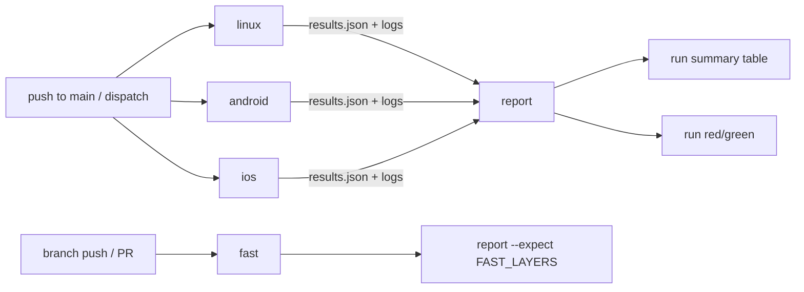

# C5 Continuous integration — design

## 1. Reviewer summary

> **Amendment (implement, 2026-10-18).** The repo is now public, so minutes are free. A PR is now
> required to merge into `main`. User rulings:
> - **Triggers:** no schedule. Fast checks run on branch pushes and on `pull_request` to main. The
>   full sweep runs on push to main and on manual dispatch.
> - **Removed:** the skip rule (old decision 4) and caching (old decision 5).
> - **Required check:** `fast` becomes required on PRs. The user applies the ruleset change after
>   C5 merges.
> - **Docs-only PRs** run the real fast checks rather than short-circuiting green.
> - **Kept:** `workflow_dispatch` and its inputs.
>
> Decisions 2, 4 and 5 are amended in place below. Slice 5's gate, marker and skip code is removed,
> and slice 7 (caching) is dropped.

**Basis.** CI is a set of thin GitHub workflows on top of the **existing sweep**. The sweep gains one
degree of freedom (run a chosen subset of its layers) and one output (a per-layer verdict file). A
small **report** step in `tools/sweep/` combines verdict files from several jobs against the layers
it expected, so a layer that never ran is red. *Rejected:* a workflow-native basis where GitHub job
conclusions are the verdicts. It would restate the layer list and the green rule in YAML, it can't
see a layer that ran zero tests, and only real runs could test it.

**Runner facts (confirmed).**
- Standard Linux runners support KVM-accelerated emulators.
- arm64 macOS runners cannot nest virtualisation, so Android runs on Linux and iOS on macOS, as the
  spec defaults.

**Decisions**
1. **Layer switch** `tools/full-sweep --layers <id,…>`.
   - The ids are `app`, `endpoint`, `self-test`, `e2e-ios` and `e2e-android`, owned by `sweepLayers`.
   - The id is a layer's identity. Display labels (`e2e (ios)`, `sweep self-test`) are derived from
     it, so local output is unchanged.
   - No switch = all five, in today's order.
   - *Rejected:* named presets, a second vocabulary.
2. **Sweep topology:** three parallel jobs (`linux`: app, endpoint, self-test; `android`: Linux KVM;
   `ios`: macOS), then a `report` job. *Rejected:* fast layers and Android on one runner. Gradle and
   the emulator compete for memory.
3. **Verdicts cross jobs as files.**
   - Each sweep also writes `test-results/sweep/results.json`, uploaded with the logs.
   - `report` combines them against the expected ids and writes the per-layer table to the run
     summary. It fails the run unless every expected layer is green. A missing layer is red, with
     "no result" as its reason.
   - `report` and `runSweep` share **one run-verdict predicate**.
   - *Rejected:* job conclusions, which can't name the layers of a job that never started.
4. **Triggers (amended).**
   - `push.yml` (the `fast` job) runs on `push` to every branch except `main`, with the docs-only
     `paths-ignore`, and on `pull_request` to `main` with **no** path filter. A required check must
     always report, so docs-only PRs run the real fast checks.
   - `sweep.yml` runs on `push` to `main` (with the same docs-only `paths-ignore`) and on
     `workflow_dispatch` (inputs `withhold_job` and `ios_simulator`).
   - Every job gets `contents: read` only.
   - *Rejected:*
     - a nightly schedule plus skip rule: that was budget-driven, and a merge-commit sweep proves
       the same thing sooner;
     - short-circuiting `fast` green on docs-only PRs: a green that ran nothing;
     - a full sweep on PRs: E2E stays on demand before merge.
5. **No dependency caching (amended).** Minutes are free. The trial showed a warm Linux job saves
   about 30 s. A cold run also proves a clean build every time. *Rejected:* the per-cache composite
   action from the slice-7 trial.
6. **Flutter is pinned to an exact version** in `app/pubspec.yaml` `environment.flutter`, which CI's
   Flutter setup reads.
7. **Linux portability with no CI-only branches in `tools/`.**
   - JDK resolution moves to the Android paths only (`e2e android`, `dev-app android`).
     - macOS uses `java_home` as today.
     - Elsewhere it trusts `JAVA_HOME` and fails fast if its major version ≠ `ANDROID_JDK_VERSION`.
   - A new dev.env value, `ANDROID_EMULATOR_FLAGS`, is empty locally. CI overrides it through the
     environment for a headless emulator.
   - This updates DECISIONS.md's build-time JDK entry.
   - *Rejected:* `if CI` branches inside `tools/`.

**Guiding principles**
- Workflows contain only `tools/full-sweep --layers …`, `node tools/sweep/report.ts`, and runner
  preparation (toolchains, device creation). They never contain a test command or a green rule. A
  self-test ratchet rejects literal `flutter test`, `vitest` and `patrol` invocations in
  `.github/workflows/`.
- Device prep sources `tools/dev.env` and **creates** the devices it names, but never boots them.
  Booting, and boot failure, stay in the sweep (G4).
  - Prep failures don't stop the sweep step (`!cancelled()`), so the sweep's own boot check names
    the device.
- CI overrides dev.env values only through the environment.
- "Green" is decided only by `whyRed` (per layer) and the shared run-verdict predicate (per run).
- The local sweep's output and exit rule are unchanged. New outputs are additional files.
- Third-party actions are pinned by SHA. PRs use `pull_request`, never `pull_request_target`.
- **Concurrency.**
  - Fast checks: one group per ref, `cancel-in-progress`.
  - Sweep: one group per ref, no cancel. GitHub keeps one pending run per group, so a newer `main`
    push replaces a pending sweep. That's accepted. A running sweep is never cancelled.

**Risks / blast radius.**
- The `tools/lib` changes reach local `e2e` and `dev-app`. The unchanged-local-sweep AC and the
  local full sweep guard them.
- The Android job is tight on memory and disk. The app's 8 GB Gradle heap sits beside a 4 GB
  emulator, which is why the Gradle heap fix exists.
- Android E2E is red on every `main` sweep until B1 is fixed (user ruling).

**Unknowns,** each surfaced in the slice that builds its platform:
- whether AVD creation for `Pixel_9_Pro_XL_-_Android_15` works with headless emulator flags;
- whether the `macos-26`/`xcode-27` image has an "iPhone 17" device type and runtime.

**Not changing:** the E2E tests; the local sweep summary and exit rule; pipeline skills (the user
changed the PR route outside C5); deployment (none).

**Ruleset (user-applied, after C5 merges).** The user adds `fast` as a required status check to the
`main` ruleset (id 25351486). The PUT must carry every existing rule and parameter through unchanged,
including `require_extra_approval_for_unattributed_changes`. Until then, PIPELINE's "wait for the
required `fast` check" step has nothing to wait for.

**Gate rulings**

Grilling round 1:
- self-cancel, with `actions: write` on `gate` only (superseded by the amendment);
- `--layers` ids;
- dependency caching in scope (superseded by the amendment);
- Flutter pinned in the pubspec.

Design gate:
- basis A;
- decisions 1–7 as written, with build outputs kept out of the cache;
- review fixes R1–R4 accepted:
  - R1: `report` runs only on non-cancelled sweeping runs, with the marker rule;
  - R2: `withhold_job` input and a real cancelled-then-resweep check;
  - R3: prep failures don't stop the sweep;
  - R4: homes for the expected set and toolchain versions;
- minors folded in;
- a queued manual run replacing a pending nightly accepted.

Implement amendment (2026-10-18), user rulings:
- no nightly;
- fast on branch pushes and PRs;
- full sweep on push to main;
- `fast` required (user applies);
- docs-only PRs run the fast checks;
- keep dispatch and its inputs;
- drop caching;
- keep the Gradle heap fix as its own change.

## 2. Basis and decomposition

**Candidate A (chosen): extend the sweep.** The concepts:
- **Layer** (existing; gains an id).
- **Selection** (ids to run; default all).
- **Verdict file** (per layer: id, label, verdict, reason).
- **Report** (expected ids + verdict files → summary table, run verdict).

How each AC falls out:
- Branch push or PR = one Linux job with `--layers $FAST_LAYERS`, followed by
  `report --expect $FAST_LAYERS`.
- Failing layer named = the report table plus the attached logs.
- Job never started = an expected id with no verdict is red.
- Device failure = the sweep's existing `fail` line becomes the verdict's reason.
- Docs-only = `paths-ignore` on both push triggers. None on `pull_request`.
- Supersede and sweep independence = separate per-workflow concurrency groups.
- Main push and dispatch = the sweep workflow's triggers.

*What it makes hard:* `tools/sweep/` learns a little about GitHub (the step-summary markdown, kept
inside `report.ts`). "Job never starts is red" depends on `report` itself starting. If it doesn't,
only GitHub's own run error shows.

**Candidate B: workflow-native.**
- One job per layer, with job conclusions combined in YAML.
- It needs fewer `tools/` changes.
- But the layer list and the green rule are restated in YAML, "zero tests" is invisible across
  jobs, and only real runs can test it.

**Seams:**
- `sweepLayers`: the only list of layers.
- `results.json`: the only verdict format.
- The run-verdict predicate: the only run-level green rule, shared by `runSweep` and `report`.
- `tools/dev.env`: the only device, JDK and CLI-version values.

UI sketch: none. There is no app change, and the surfaces are GitHub's own.

## 3. Single-home register

| Business rule | Single home | Paths that consume it |
|---|---|---|
| The sweep's layers, ids, labels, order | `sweepLayers` (`tools/sweep/layers.ts`) | local `tools/full-sweep`; `--layers` parsing; `fast` job; `linux`/`android`/`ios` jobs; `report`'s default expected set; `sweep.test.ts`; PIPELINE.md full-sweep row; README.md layer list |
| A layer is red if it exits non-zero or runs zero tests | `whyRed` (`tools/sweep/sweep.ts`) | every sweep, local and CI |
| A run is green only if every expected layer is green; missing = red | run-verdict predicate (`tools/sweep/verdict.ts`) | `runSweep` (local `ok`); `report` in the `fast` job and the sweep's `report` job |
| Fast checks = `app,endpoint,self-test` | `FAST_LAYERS` env in `push.yml` | `fast` job's `--layers` and `report --expect`; PIPELINE.md CI row points to it |
| Docs-only push | `paths-ignore` in `push.yml` **and** `sweep.yml`. YAML can't share it, so the self-test asserts the two lists are identical. | both push triggers (never `pull_request`) |
| Device names, AVD API level and device profile, emulator flags | `tools/dev.env` (`IOS_SIMULATOR`, `ANDROID_AVD`, `ANDROID_AVD_API`, `ANDROID_AVD_DEVICE`, `ANDROID_EMULATOR_FLAGS`) | `tools/lib/devices.sh` (via `tools/e2e`, `tools/dev-app`); CI device prep (sources it); CI env overrides; CONVENTIONS.md dev.env convention |
| JDK version and resolution | `ANDROID_JDK_VERSION` in dev.env; resolution in `tools/lib/common.sh` (Android paths) | `tools/e2e android`; `tools/dev-app android`; CI JDK setup |
| Endpoint values reaching the app | dev.env → `endpoint_dart_defines` | `tools/e2e`; `tools/dev-app`; `app/lib/endpoint/dev_endpoint.dart` (unchanged) |
| Flutter version | `app/pubspec.yaml` `environment.flutter` (exact) | Flutter setup in every CI job; local `pub get` |
| Node version | root `.nvmrc` | setup-node in every CI job |
| Patrol CLI version | `PATROL_CLI_VERSION` in dev.env | CI Patrol install (`ios`, `android` jobs) |
| Xcode image | `ios` job's `runs-on` label | `ios` job only (CI-only fact) |

## 4. Data shape

No database.
- `results.json`: one entry per layer that ran (id, label, verdict, reason).
- Artifacts: `sweep-<job>` (logs and results, 14-day retention).
- No caches and no marker.

## 5. Test strategy

- **Outer tests are real GitHub runs** (the surface is GitHub; Patrol doesn't apply). Each slice's
  demo is a real push, PR or dispatch, with run links captured in the demo pack.
- **The sweep self-test is the integration layer** (real processes, real files). It covers:
  - `--layers` selection and the unchanged default;
  - `results.json`;
  - `report` combining results, including a missing job and a zero-test layer;
  - JDK fail-fast;
  - the workflow-command ratchet;
  - the two docs-only lists being identical.

  Running it on Linux in CI is itself the portability proof.
- **Real negative cases**, each a demo once:
  - The manual sweep's `withhold_job` input (a false `if` on one job) must show that job's layers
    red.
  - An `ios_simulator` override set to a missing name must name the device.
  - A docs-only push must start no run.
  - A docs-only PR must still report `fast`.
  - A newer push must cancel the older push run.
- **The local-unchanged AC:** the self-test asserts the default selection and labels. The local full
  sweep must stay green.

## 5a. Failure posture

The `main` sweep is a background job, so the default doesn't apply. `report` fails the run, and
**GitHub's failure email** raises it to a human.
- If a runner never starts, GitHub's own run error is the visible signal (per the spec).
- No retries.

## 6. Definition delta

No area doc changes: this is developer tooling, and `docs/definitions/` holds product behaviour.
- `docs/PIPELINE.md` gains a CI row, and its full-sweep row lists the layer ids. The CI row notes
  that `fast` becomes required only once the user updates the ruleset.
- `docs/DECISIONS.md`:
  - gains a C5 entry: the runner facts, decisions 2–5 and the triggers;
  - supersedes G3 (the repo is public);
  - drops D1's "minutes shared with C5" note;
  - updates the build-time JDK entry (decision 7).
- `docs/CONVENTIONS.md`'s dev.env note gains the new values.
- The C5 BACKLOG line is removed at finish.

## 7. First slices

1. The developer pushes a branch and sees a green check from a Linux job that ran
   `tools/full-sweep --layers self-test`, with its log attached. This is the walking skeleton:
   `tools/` starting on Linux, the switch, artifacts.
2. The developer pushes a change that breaks the endpoint tests and sees a red check whose run
   summary names `endpoint`, with `endpoint.log` attached.
3. The developer starts the full sweep manually on a branch and sees the Android E2E verdict from the
   KVM job beside the fast layers in the five-layer table. iOS shows red, "no result", until the
   next slice.
4. The developer starts the full sweep manually and sees the iOS E2E verdict from the macOS job.

## Slices

- [x] 1. The developer pushes a branch and sees a green check from a Linux job that ran `tools/full-sweep --layers self-test`, with its log attached
- [x] 2. The developer pushes a change that breaks the endpoint tests and sees a red check whose run summary names `endpoint`, with `endpoint.log` attached
- [x] 3. The developer starts the full sweep manually on a branch and sees the Android E2E verdict from the KVM job beside the fast layers in the five-layer table; iOS shows red "no result"
- [x] 4. The developer starts the full sweep manually and sees the iOS E2E verdict from the macOS job
- [x] 5. ~~The nightly schedule sweeps an unswept trunk head and leaves a marker; a later night self-cancels~~ (superseded by the amendment; its code is removed in slice 7)
- [x] 6. The developer starts the manual sweep with `withhold_job` (or an `ios_simulator` override naming a missing device) and sees that job's layers red / the device named
- [ ] 7. A code push to main runs the five-layer sweep with no gate job, and the self-test no longer has a skip predicate: the sweep is triggered by `push: main` + dispatch (schedule, gate, marker, `skip.ts`/`gate.ts` and their tests removed)
- [ ] 7b. The developer opens a docs-only PR to main and sees the `fast` check report on it (fast workflow gains `pull_request` with no path filter, branch pushes exclude main; the self-test asserts both docs-only lists are identical)
- [ ] 7c. The Android job sizes Gradle's heap to fit beside the emulator, and the sweep's Android layer reaches a verdict rather than being killed
- [ ] 8. The self-test rejects a test command written into a workflow, and PIPELINE.md has the CI row

## Decisions taken during implement

- **Labels are set beside ids in `sweepLayers`** (`e2eLayer` builds both from the platform) rather than computed from the id by a lookup — one place, no second mapping.
- **The app layer pins `flutter test --reporter expanded`.** Under `GITHUB_ACTIONS` Flutter picks its GitHub reporter, whose summary (`🎉 14 tests passed.`) the counter doesn't read; fixing the reporter keeps one count regex for local and CI. *Rejected:* counting both formats.
- **`report.ts` takes one results root and reads every `results.json` under it**, and prints the table to stdout as well as the step summary (the summary isn't readable through the API, and the log should name the red layer too).
- **CI's AVD uses the `pixel_7_pro` profile** (`ANDROID_AVD_DEVICE` in dev.env): the SDK command-line tools define nothing newer, even at `cmdline-tools;latest`; the local AVD is an Android Studio Pixel 9 Pro XL, a near-identical screen. *Rejected:* committing a custom `devices.xml`; a CI-only override (would leave the dev.env value dead).
- **Runner preparation for Android grew three CI-only facts**, all in the workflow: free ~20 GB of disk (the emulator's userdata partition needs ~7.4 GB and the image leaves ~4.8 GB after the build), pin `ANDROID_AVD_HOME` (the runner's `XDG_CONFIG_HOME` sends avdmanager and the emulator to different homes), and put `platform-tools` on `PATH` for Patrol.
- **A `toolchains` composite action** (`.github/actions/toolchains`) is the one place jobs set up Node, Flutter and the endpoint's packages from their pinned versions.
- **iOS runs on `runs-on: xcode-27`** (macOS 27, Xcode 27.0 default, nearest to the local Xcode 27.1); its image ships "iPhone 17", so device prep is create-if-missing.
- **A missing layer's reason reads "no result (its job did not run or did not finish)"**: the first real case was an Android job killed mid-sweep (exit 143), not one that never started.
- ~~**The skip check uses two API calls**~~, ~~**`gate` checks on every event**~~, ~~**the marker is uploaded by a step after `Report`**~~: slice-5 choices, superseded by the amendment (no schedule).
- **TEMPORARY `push: c5-trial/**` trigger on `sweep.yml`**: `workflow_dispatch` works only once the workflow is on main, so pre-merge trials run by pushing throwaway `c5-trial/*` branches. It stays through slices 7–8 (a `push: main` trigger can't be trialled before merge either), and is removed before `/finish-feature`. C5's own merge commit is the first real `main` sweep.
- **`.nvmrc` pins Node 26.8.1** (the local version; the sweep relies on Node's native TypeScript stripping).
- **Amendment, 2026-10-18** (user rulings, see § 1): the repo went public and `main` became PR-only. The nightly, skip rule and caching are dropped; the full sweep runs on push to main; fast runs on branch pushes and PRs; `fast` becomes required (the user applies the ruleset). *Rejected:* short-circuiting `fast` green on docs-only PRs (a green that ran nothing, and a third copy of the docs-only list).
- **The Gradle heap fix is its own change, not caching.** The slice-7 trial's Android job was killed at about 14 min until `~/.gradle/gradle.properties` capped Gradle at 2 GB beside the 4 GB emulator. After that it reached a real verdict (red: B1).

## Resume

- Closed: slices 1 (20e4e5f), 2 (4f5458f + b835717), 3 (4ceb9b6), 4 (9cde0c9), 5 (2b5db7d, superseded), 6 (55b30f0). TDD logs in `test-results/tdd/C5/`. Slice 7 (caching) was dropped after its trial on `c5-trial/s7`. That log stays as a record of the trial.
- origin/main (with B1 and the user's PR-flow edits) is merged into the feature branch (7c411d1). The amendment is the commit after it.
- Next: slice 7 — *a code push to main runs the five-layer sweep with no gate job*. Remove `schedule`, `gate`, the marker steps, `tools/sweep/skip.ts`, `gate.ts`, `skip.test.ts`, `gate.test.ts`, and `report.ts`'s `reached_verdict` output (check whether anything else consumes it). `report` keeps `!cancelled()`. Add `push: branches: [main]` with the docs-only `paths-ignore`. Keep dispatch and its inputs, and keep the TEMPORARY trial trigger.
- Then 7b (fast workflow `pull_request`, branches-ignore main, docs-only lists equal in the self-test), 7c (Gradle heap, from 1fe15c9), 8 (ratchet, PIPELINE CI row noting that `fast` is required only after the user's ruleset change, CONVENTIONS dev.env note, README layer ids).
- **After merge, at finish:** remove the TEMPORARY trigger. Prove manual dispatch. C5's merge commit must produce a real `main` sweep (red on Android: B1). The user then adds `fast` as a required check (ruleset 25351486; carry the existing params through unchanged). Throwaway remote branches to delete (OK still not given): `c5-demo/endpoint-red`, `c5-demo/endpoint-red-2`, `c5-trial/s3`–`s7`. Mention auto-merge (`gh pr merge --auto` plus the repo setting) as an optional follow-up.
- Seams as built: `Layer = { id, label, command, cwd, countTests }`; `selectLayers(layers, ids?)` + `listSwitch(args, name)` in `layers.ts`; `LayerVerdict` + `runVerdict(expected, verdicts)` in `verdict.ts`; `runSweep` writes `sweep/results.json`; `node tools/sweep/report.ts [--expect ids] <results-root>` → stdout + `$GITHUB_STEP_SUMMARY`, exit 1 unless green. `use_android_jdk` (common.sh) on Android paths only. dev.env gained `ANDROID_AVD_API`, `ANDROID_AVD_DEVICE`, `ANDROID_EMULATOR_FLAGS`, `PATROL_CLI_VERSION`.
- `gh` and `git push` work only outside the sandbox (TLS fails inside), and so does writing `.claude/skills/` (a merge touching skills needs the sandbox off). Force-push is refused — never amend a pushed commit.
- Measured (cold): push job ~2 min; sweep linux ~2 min; android ~21 min with the heap fix; iOS ~10.7 min wall.
