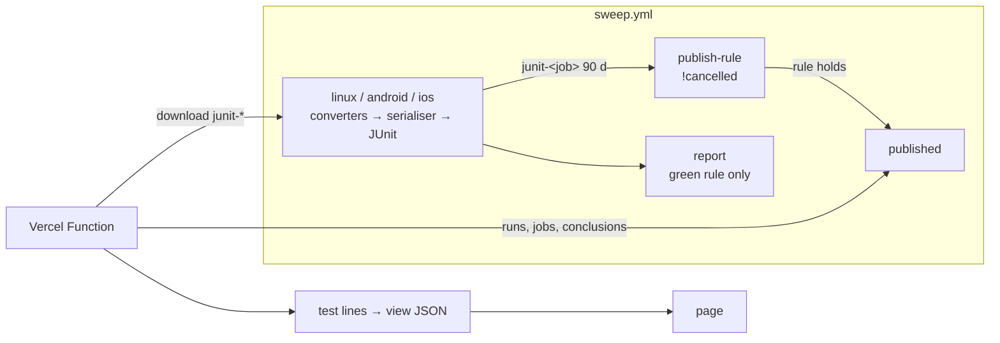

# C8 S1 Latest run: design

Covers stage S1 of `specs/C8-test-status-site.md`. S2 and S3 each get their own design.

## 1. Reviewer summary

**Basis (J).** The contract between the sweep and the site is **JUnit plus GitHub Actions job status**, and nothing else.

**The sweep** turns each layer's results into **normalised JUnit**:
- one `<testsuite>` per folder;
- one `<testcase>` per test, named as the runner reports it, with its file as `classname`;
- commit and sweep time as `<properties>` on the root.

Each test job uploads that JUnit as `junit-<job>`. A `publish-rule` job evaluates the publish rule, and a `published` job succeeds only on publishing runs.

**The status-site app** (`status-site/`, a Git-connected Vercel project `skimapper-tests`) knows only JUnit and job status. It:
- shows the highest-numbered published run;
- fills in missing folders from the job's last published artifact, giving the job's conclusion as the reason;
- applies the display rules;
- serves a view that the page's JS renders.

Rejected: the app reading raw reporter output plus layer descriptors or a run record (A / A′). It's more precise about partway stops, but you ruled anything beyond JUnit and job status to be coupling.

**Decisions**

1. **The app's only inputs are JUnit, job status and its own static content** (the never-checks list). The GitHub API is used only to list runs, jobs and artifacts and to download artifacts.
2. **One JUnit writer.** Each source converts into one record list (file, name, status): Vitest's JSON reporter, a small Node test reporter module of our own (no install), Flutter's `--file-reporter json`, and Patrol's per-test log lines. One serialiser in `tools/sweep/` then applies the folder rule from `layers.ts` (folder prefix plus the path below the layer's test root) and the root properties, and writes the JUnit. There's no XML parsing in `tools/`. Each layer's default stdout stays, so `countTests` and the green rule don't change. A converter that throws writes an `error:` line, so the job fails. Rejected: the runners' built-in JUnit reporters plus a normaliser (an XML parser in a `tools/` with no package install).
3. **The store is per-job `junit-<job>` artifacts** (artifact name = job id), kept 90 days and uploaded with `overwrite: true`. A re-run replaces that job's artifact, so a run shows its latest attempt. `sweep-*` stays at 14 days. A converter fix does not reach past runs.
4. **The publish rule is a TypeScript predicate in `tools/sweep/`:** main, and either a push or a dispatch with default inputs (a push has empty inputs). A `publish-rule` job runs after the three test jobs whatever their outcome (`!cancelled()`) and sets an output. `published` runs only when that output is true. **Red runs publish.** `report` keeps only the green rule. **Latest** is the highest run number among runs whose `published` job succeeded (the re-run guard).
5. **Missing results are filled from job status.** The **test jobs** are the jobs with a `junit-<job>` artifact in the run shown or in the last published run, so `report`, `publish-rule` and `published` never appear. A folder is filled in, as "no result this run", when it was in the job's last published artifact and is missing now, and the job either **uploaded nothing** (never ran, cancelled, timed out, withheld) or **concluded failure**. That catches an E2E group abort after a failure, and a `linux` layer that reported nothing. The reason is the job's conclusion in plain words ("the android job failed before reporting them"). Backfilled lines come from an older commit.
6. **There are no synthetic test reports, and no count check.** A partial drop inside one folder is not shown. A deleted folder shows wrongly only while its job is failing.
7. **The data is read when the page is requested,** by one Vercel Function with a CDN cache of about 5 minutes. Error responses are `no-store`. There's no framework, the page JS only renders, and access is a fine-grained read-only token (this repo, Actions: read) in a Vercel environment variable. A sixth sweep layer, `status-site`, runs in the `linux` job and in `push.yml`'s `FAST_LAYERS`. Its `npm ci` runs only in those two jobs.
8. **`?run=<id>`** shows any **published** run everywhere (S2 will need this). Preview deployments also show **unpublished** runs, with a "not published" banner, filling in from earlier completed runs on the same branch.

**Guiding principles**
- The sweep's serialiser is the only writer of JUnit; the app's reader is its only reader. One captured example in `status-site/` is tested on both sides.
- The app never names a layer. It names a job only through the `junit-` prefix, and `published` through the publish wiring.
- Every status is decided once, in the function. The page renders.
- The line key is folder + testcase name. Relaunch parts pair on folder + `classname`, named "<part 1>, then <part 2>". The rename pass keeps the `relaunch k of 2:` prefixes (D7).
- Commit and time come only from the run's own artifacts, never a backfilled one; the time is the latest stamped. A run with none says "this run produced no test results".
- A read or parse failure, a bad token or a name collision replaces the page with one error naming the run and the reason.
- The green rule is untouched. The run summary gains only the `status-site` row.

**Risks / blast radius.**
- The sweep gains: converters and a serialiser, three uploads, the `publish-rule` and `published` jobs, the sixth layer, and a `FAST_LAYERS` change.
- `status-site/` is new.
- The app and the Worker are untouched apart from the test-name rename. The rename reorders tests within an iOS group (D7), so that slice runs the full E2E sweep.

Unknowns, each checked in the slice that first needs it:
- which conclusion a job-level `timeout-minutes` reports;
- whether Flutter's `--file-reporter json` works alongside `--reporter expanded`;
- whether Vitest's JSON reporter and our Node reporter work alongside their default stdout reporters;
- how Patrol's per-test lines attribute a test to its file and group in the E2E log, and anchoring them to the line start so app logs can't spoof a result (as D7 does for the count);
- whether Patrol's iOS lines carry the Dart name exactly as written;
- whether 90-day retention is allowed;
- how `overwrite: true` behaves on re-runs.

Flutter names carry their `group()` prefix; they're shown as reported.

**S2 forward-fit.** Reading every run at request time leaves room for an index or cache, if 90 days of runs per request proves slow. Noted, not built.

**Spec requirement driving disproportionate complexity.** None remaining. The JUnit contract took the normalised-record lever.

**Not changing.** What the existing layers test and how they're counted, the green rule, `report`'s role, the app, the Worker.

**Questions the gate ruled on.**
- Hosting: Vercel (Git-connected, request-time), replacing GitHub Pages.
- Inputs limited to JUnit plus job status.
- Per-job artifacts and their naming.
- No synthetic reports; the count check dropped.
- Commit and time from JUnit properties.
- Red runs publish through `publish-rule` → `published`.
- Latest = highest run number.
- A failed job's missing folders are filled in (option c).
- Preview `?run=`.
- One serialiser.
- `FAST_LAYERS`.
- Error responses `no-store`.
- Re-runs show their latest attempt.
- UI: tallies; folders with a failure or no result open, all-passed folders closed; the never-checks list above the results; the reason once per folder; the empty state; the whole-page error.
- The rename pass as its own slice; status only in S1.
- The slices below, with slice 4 verified after merge.

## 2. Basis and decomposition

**Candidate J (chosen): JUnit plus job status as the contract.**
- *Sweep*: `Layer` (existing) gains its converter and its folder prefix and test root; one **serialiser** writes JUnit; **publish-rule** wiring.
- *App*: **published runs** (listing, latest, `?run=`, window); a **JUnit reader**; **test lines** (fill-in, pairing, collision); the **view**; the **page**.

How the ACs fall out:
- *Published*: `published`, then the latest run, then JUnit, then lines, then the view.
- *Failed visible*: a `<failure>`, then the roll-up.
- *Reported nothing / stopped partway*: job status plus the last published artifact, at folder granularity.
- *Runs that don't publish*: `published` is skipped.
- *Limits*: the static list.

What it makes hard:
- a partial drop inside one folder;
- converters that under-report, which is silent with no count check;
- the JUnit shape as a cross-project convention held only by the shared example.

**Candidate A′ (rejected):** raw reports plus a run record. Precise at layer level, but coupled to sweep internals.

**Seams:**
- *the JUnit shape*: written by the serialiser, read by the reader, and the shared example is tested on both sides;
- *the GitHub API*: injected fetch;
- *lines → view → DOM*: pure.

## 2a. UI sketch

`specs/C8-test-status-site-ui.html`, published as an Artifact. It's drawn at 480px; wider screens centre about 720px. Glacier teal (F1); status is a glyph plus a word.
- Folders follow the layer order, then the path, and are labelled with the layer label ("sweep self-test").
- Times are in UTC.

Described rather than drawn: the "not published" banner, the empty state ("No published test run in the last 90 days. A full test run on main publishes one."), and the whole-page error.

## 3. Single-home register

| Business rule | Single home | Paths that consume it |
|---|---|---|
| Which runs publish | publish predicate, `tools/sweep/` | the `publish-rule` job's output, which gates `published`; the app reads `published`'s conclusion; its defaults are asserted against `sweep.yml` by the self-test |
| Folder rule and each layer's converter | `sweepLayers`, `tools/sweep/layers.ts` | the serialiser; existing: `main.ts`, `report.ts`, `workflows.test.ts`, `sweep.test.ts` via `layersFromArgs` / `sweepLayers` |
| Normalised JUnit shape | the serialiser, `tools/sweep/` (writer) | the app's JUnit reader; the shared example in `status-site/` is tested by both |
| Artifact name = `junit-<job id>` | `sweep.yml`, asserted by `workflows.test.ts` | the app's job ↔ artifact pairing |
| Latest published run, `?run=`, window | run selection, `status-site/` | test lines, view |
| Missing-folder fill-in and reason wording | test lines, `status-site/` | view |
| Header commit and time | test lines (own artifacts only) | view |
| Line key, relaunch pairing, collision | test lines | view; S2 later |
| Roll-up and tallies | view builder | render |
| Never-checks list | a static file in `status-site/` | view builder |
| Layer verdict and green rule (unchanged) | `whyRed` (`sweep.ts`), `runVerdict` (`verdict.ts`) | `report.ts`, `sweep.ts`; **not** the app |

## 4. Data / schema shape

There's no database. `junit-<job>` holds one JUnit file per layer, is kept 90 days, and is replaced on a re-run. Runs from before this feature have no such artifact, so the first published run starts the window. The view JSON is built per uncached request.

## 5. Test strategy

| Behaviour | Outer test |
|---|---|
| Each source → records → normalised JUnit; a converter error fails visibly | self-test, over output captured from a real sweep; the shared example |
| The publish rule (push and dispatch shapes, defaults matching `sweep.yml`); `publish-rule`/`published` gating on a red run; uploads, names and 90 days; six layers covered; `FAST_LAYERS` | self-test (`workflows.test.ts` and units) |
| Run selection, `?run=`, fill-in (uploaded nothing / failed), reasons, pairing, collision, header | `status-site` layer: tests over JUnit fixtures and a fake API |
| The function end to end: fake API → view; bad token; empty; error responses `no-store` | `status-site` layer: handler integration test |
| Render: statuses, roll-ups, tallies, header, never-checks, error, empty, banner | `status-site` layer: pure render tests |
| The real page on real data | demo pack: a preview with `?run=<branch dispatch>`; production verified at the first trunk runs after merge |

There's no real-browser test (ruled). Development iterates on captured fixtures; a real dispatch (about 90 minutes for E2E) is used for each slice's demo.

## 5a. Failure posture

- **Errors on the page:** read, download or parse failures, a bad or expired token, and collisions.
- **Errors in Actions:** a converter error fails its job, and its folders are then filled in as "no result" on the site. A crashed or cancelled `publish-rule` or `published` job leaves the run unpublished, which shows in Actions and as the site's age in its header.
- **Not errors:** a red sweep still publishes.
- **Accepted as invisible:** a partial drop inside a folder, and a converter that under-reports.
- **Irreversible:** nothing, apart from a re-run replacing that same run's results, which is accepted.

## 6. Definition delta

- New `docs/definitions/test-status.md`, listed in the definitions README.
- `CLAUDE.md` project map gains `status-site/`.
- `PIPELINE.md`: the sixth layer, `FAST_LAYERS`, the publish jobs, the site URL, the one-time Vercel setup.
- `CONVENTIONS.md`: the test-naming rule (reviewer checklist) and a `status-site/` stack line.
- `DECISIONS.md`:
  - a C8 entry: JUnit + job status as the contract, per-job artifacts and fill-in, no synthetic reports, `publish-rule`/`published`, request-time Vercel, `?run=`, one serialiser;
  - C5 amended: JUnit production, the publish jobs, the sixth layer, `FAST_LAYERS`. The site reads job conclusions only for "no result" reasons, never as verdicts.

Nothing is superseded.

## 7. First slices (indicative)

1. **Walking skeleton:** a developer opens the `skimapper-tests` preview at `?run=<branch dispatch>` and sees the app and the iOS and Android E2E tests by name under their folders, each passed or failed, with the folder roll-up and the commit and time from the JUnit.
2. A stakeholder sees the endpoint, self-test and status-site folders, and the relaunch pair as one line.
3. After a branch dispatch with `withhold_job=android`, the preview shows Android's folders as "no result this run", with "the android job did not run", filled in from the earlier branch run.
4. Production's latest-published and non-publishing cases are proven against a fake API before merge, and **verified for real at the first trunk runs after merge**, as recorded at sign-off.

Later: the rename pass (done when its list has been reviewed; runs the full E2E sweep), the never-checks list, skipped tests, tallies.

## Slices

- [ ] 1. A developer opens the `skimapper-tests` preview at `?run=<branch dispatch>` and sees the app and the iOS and Android E2E tests by name under their folders, each passed or failed, with the folder roll-up and the commit and time from the JUnit.
- [ ] 2. A stakeholder sees the endpoint, self-test and status-site folders, and the relaunch pair as one line.
- [ ] 3. After a branch dispatch with `withhold_job=android`, the preview shows Android's folders as "no result this run", with "the android job did not run", filled in from the earlier branch run.
- [ ] 4. Production's latest-published and non-publishing cases are proven against a fake API before merge (verified for real at the first trunk runs after merge).
- [ ] Later: the never-checks list, skipped tests, tallies, the empty state and whole-page error, the rename pass.

## Decisions taken during implement

- **`status-site/` is plain JavaScript ES modules, no build step.** The page's renderer and the function's modules load unbuilt in the browser, on Vercel and under `node --test`; TypeScript would need a build for the page and `.ts`-extension imports Vercel's function bundler may not take. Dependencies: `fast-xml-parser` (the JUnit reader) and `fflate` (artifact zips).
- **Folder order travels as a `position` property on the JUnit root**, the layer's index in `sweepLayers`, so the app orders folders by layer without naming one.
- **`classname` is the file's path below the layer's test root** (`resorts/catalogue_test.dart`), unique within a folder for relaunch pairing.
- **The `status-site` layer sits after `self-test`** (fast layers before E2E, as the local sweep runs them), so its folder shows before `ios` and `android`; the sketch drew it last.
- **The function reads the token from `GITHUB_TOKEN`** in the Vercel environment.
- **Each layer's JUnit is `test-results/sweep/junit/<layer id>.xml`**; a runner's report file (Flutter's JSON) is `test-results/sweep/<layer id>.report`.
