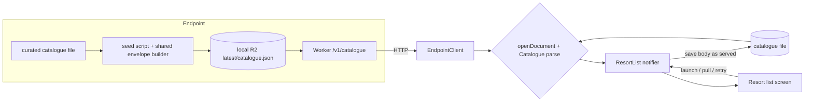

# F1 Resort list: design

Spec: [F1-resort-list.md](F1-resort-list.md). UI sketch: [F1-resort-list-ui.html](F1-resort-list-ui.html).

## 1. Reviewer summary

**Basis.** The device keeps the catalogue **envelope exactly as it was served**. The network answer
and the saved copy both become resorts through one named function, `openDocument`: it opens the
envelope, then runs the kind's parse. One Riverpod notifier owns what the screen shows. Rejected:
a model-level basis that saves the parsed resorts in the app's own format (its own JSON, or drift
rows), because it needs a second version mechanism and adds a storage schema before there is any
user state.

**Decisions**

1. **The saved copy is one catalogue file in app support storage, holding the served body
   byte-for-byte.** It is written to a temp file, flushed, then renamed into place. It is reopened
   through `openDocument`, so a corrupt copy, or one with an older or unknown schema, counts as
   "nothing saved" with no extra rule. No drift in F1: D5's migration 1 moves to F3, since
   favourites are the first user state. Rejected: drift now (two version checks, and the first
   schema to migrate from would be set before any user state exists).
2. **One reader, `openDocument(body, kind, parse)`, sits beside `openEnvelope` in
   `contract_envelope.dart`.** It returns one of three outcomes:
   - **understood**: the raw body plus the parsed value;
   - **incompatible**: a wrong kind or an unknown `schemaVersion`. This is the only case that
     shows "update the app";
   - **failed**, with its cause: a non-envelope body, or a parse that rejects the data (an empty
     or malformed catalogue).

   `EndpointClient.fetchDocument` takes the parse and calls `openDocument` in its isolate. It adds
   transport failures (unreachable, timeout, any non-2xx) to *failed*, each keeping its cause. So
   classification finishes, and is logged, in one place, as D8 requires. The catalogue's `data`
   stays an object (`{resorts: [...]}`), so the envelope's shape is unchanged. Rejected: keeping
   D8's "not understood" (it lumps non-2xx in with "update the app", which the spec reverses), and
   parsing the catalogue in the notifier after the client says *reached* (two homes for the
   classification).
3. **Riverpod, without code generation.**
   - There are three hand-written providers: the endpoint client, the catalogue store and the
     resort-list notifier. Their defaults are the real dev endpoint client and the app support
     store.
   - `ProviderScope` sits inside `SkimapperApp`, so `main()` and Patrol, which pumps
     `SkimapperApp` without calling `main()`, both get one.
   - Patrol overrides nothing. Widget tests wrap the screen in their own `ProviderScope` with
     overrides: a fake HTTP client and a temp-directory store.

   Rejected:
   - no state library (constructor injection plus a plain `ChangeNotifier`). This carries F1 with
     fewer concepts, but the user chose to settle the framework now, ahead of the shared list state
     F2-F4 need;
   - `riverpod_generator`, which adds build_runner to the TDD loop, CI and the sweep for three
     providers. Hand-written and generated providers can coexist, so codegen can come in later.
4. **Request ordering is explicit in the notifier's apply step, not Riverpod's
   rebuild-on-refresh.**
   - Each fetch gets a generation number.
   - An answer older than the newest applied *understood* answer is dropped, whatever it is.
     Failed and incompatible answers never advance the applied generation; they are judged against
     the state when they land.
   - The launch fetch's answer is applied only after the saved-copy read has been applied, so a
     fast offline failure can't beat the saved list to the screen.
   - Saves are chained, and only the newest understood answer is written, so an earlier save can
     never rename into place last.

   Rejected: an `AsyncNotifier` refreshed with `ref.invalidateSelf`, whose built-in stale-result
   dropping is "only the newest request counts", the rule ruled out at grilling.
5. **E2E tests change the endpoint mid-run through a log-marker channel.**
   - A test prints a tagged request line, and `tools/e2e` reacts with its existing bash functions.
   - There are two requests:
     - **stop the endpoint**;
     - **serve catalogue <variant>**: stop, seed, start. A restart, not an in-place write to a
       running Miniflare.
   - Requests are idempotent, because log lines can be duplicated. An unknown request fails the
     run.
   - The test then probes `/v1/catalogue` through `EndpointClient` and `openDocument` until the
     change can be seen, with a timeout that fails visibly.
   - **The watcher never reads a pipe.** Patrol's output goes to a file, which the harness shell
     polls while Patrol's PID is alive, so the loop ends on Patrol's exit, not on EOF. This avoids
     D7's daemon-held pipe, and keeps `ENDPOINT_PID` in the harness shell.

   Supporting changes:
   - `clearPackageData` becomes `false`;
   - a relaunch is two ordered test cases in one file;
   - every test in the scripted group states its saved-state and endpoint-state preconditions at
     its start.

   Rejected: a host control HTTP server (a new process driving state that the bash harness owns);
   an on-device fake server (the pull scenario would no longer hit the real Worker).
6. **Accents and capitals are folded by one shared function**: the `diacritic` package plus
   lowercasing, with ties broken on the original string. F9's search uses the same function.
   Rejected: our own folding table.
7. **When saving fails, the new list is still shown.** The failure is reported through
   `FlutterError.reportError` plus a debug run-record line. The flushed rename keeps the previous
   copy intact. Rejected: a visible "couldn't save" message.
8. **Home screen layout, a temporary arrangement for F1 only** (sketch § 1):
   - The list takes the flexible space and scrolls.
   - The fixture map block (map, map line, attribution) stays pinned below it at today's 240 px.
   - Full-screen states fill only the list area and stay pullable.
   - Rows show the name, with the countries below in smaller type, and nothing tappable.

   **This is not the target.** In the intended end state the resort list and a map are never on
   screen together: the list stands alone, and choosing a resort opens its map (F4/F5). F4/F5
   move or retire the fixture-map proof. `/finish-feature` writes that target, not the pinned
   layout, into the area doc. Rejected: the map scrolling away under the list (it would move the
   attribution off-screen); moving the fixture-map proof to an unreachable test-only screen now.
9. **"Update the app" over a saved list is a MaterialBanner at the top of the list area**, with no
   Dismiss. It clears when a later answer is understood, and stays if a later pull fails (that
   pull's snackbar shows as well). With nothing saved, the full-screen prompt has a Retry button,
   like "couldn't load". Rejected: a floating card (it covers rows); a Dismiss control (not in the
   spec).

**Guiding principles**

- **One reader.** Bytes from the network, from disk, or from an E2E probe become resorts only
  through `openDocument` with the catalogue parse.
- **The notifier is the only writer** of the shown list and the saved copy. Widgets render one
  state value and send intents (launch, pull, retry). E2E clears the saved copy through the store's
  own clear, never by path.
- **What the skier sees is decided in one place**: the notifier's apply step, from the outcome,
  the trigger (quiet launch, or the user's pull or retry) and whether a list is shown. It is one
  mapping, and the spec's failure-states table can be tested against it directly.
- **Order and countries are derived at display time** from the parsed catalogue (folded-name sort,
  "France · Italy"). Nothing is stored sorted. The curated file is deliberately not in name order.
- **E2E tests never inherit state from another test.** Saved state and endpoint state are each a
  stated precondition. Only the second half of a relaunch pair continues its first half, in the
  same file.
- **The curated list has one home in the repo**, and the seed script derives every E2E variant
  from it. Patrol assertions on the three names and "France · Italy" are the spec AC's own
  literals. The extra area's name reaches the test as a dart-define from the harness, in place of
  `E2E_SEEDED_MESSAGE`.

**Risks / blast radius.** Retiring the skeleton message touches every E2E group, the endpoint's
readiness path, the dev-app seed, D9, the docs that name the groups, and `run-record.test.ts`'s
fixture strings. Turning off `clearPackageData` changes Android test isolation, though Patrol
still uninstalls at every group boundary.

**Technical unknowns** (the first two slices find these out):
- whether tagged lines reach the harness's polled output file promptly. Patrol's log reader
  streams logcat and `simctl log stream` live; about a second of latency is expected on iOS;
- whether the file-polling watcher runs cleanly under Gradle's daemons;
- whether Patrol runs a file's tests in declared order under the Android orchestrator. It does on
  iOS. The fallback is two Patrol invocations, both with `--no-uninstall`, sequenced by the
  harness.

**Spec requirement driving disproportionate complexity.** The two end-to-end ACs that change the
endpoint mid-run (relaunch offline, pull after a change) are why the channel and the
test-isolation change exist. The lever would be to prove pull-to-refresh with a widget test. That
saves only the "serve variant" request, because stopping the endpoint still needs the channel, and
it gives up the only proof that a pull really refetches from the Worker. Recommendation: no
change.

**Not changing.**
- The fixture map proof, its map line and the attribution line.
- `EndpointClient` still fetches in a background isolate, with its debug fetch log.
- The envelope's shape (`kind`, `schemaVersion`, `dataVersion`, object `data`).
- The R2 key layout's shape (`latest/<name>.json`).
- `/v1/` route versioning.
- No deploy (C8), and no resort id in the catalogue (F3 adds it).

**Gate rulings.**
- **Ruled by the user:**
  - **Decision 8:** the pinned map block is agreed as a temporary F1 layout only. The target is
    the list alone, with a resort's map opening once it is chosen (F4/F5).
  - **Decision 9:** Retry on the full-screen "update the app" is agreed. Banner A, with no Dismiss,
    clears on a later understood answer and stays on a failed pull: agreed.
  - **Sketch fidelity:** the sketch is a structural mock-up. The real look comes from the Material
    3 widget defaults (F21 owns theming), and the demo-pack gate compares real screenshots against
    it.
- **Settled by the grilling answers, or following from them:**
  - basis A;
  - decisions 1-7: decision 3's no-codegen was flagged as borderline and not objected to;
    decision 4 is the grilling rule plus the offline-race fix;
  - the guiding principles;
  - Riverpod confirmed over no state library;
  - the untested bash request guard, accepted because it fails visibly;
  - no simplification lever taken;
  - slices 1-4.

## 2. Basis, then decomposition

**Candidate A: document-level (recommended).** The concepts are as follows:
- **The envelope** owns compatibility. It gains `openDocument`: the missing degree of freedom
  "open, then parse for this kind", with the three-way outcome.
- **`EndpointClient`** owns transport and adds transport failures to the outcome.
- **`Catalogue`** is a new value type and the catalogue parse. It owns what an understood
  catalogue is: at least one entry, each with a name, a non-empty countries list and a centre
  point. It also owns the folded-name order and the countries label.
- **A catalogue store** is new. It holds one file: written flushed and atomically, read back as
  raw bytes or nothing, and clearable.
- **The `ResortList` notifier** is new. Its single output is one screen state: the list shown (if
  any), the first-load status (loading, couldn't load, update the app), the update banner, and a
  one-off "couldn't refresh" event. It owns request ordering.

How the ACs fall out:
- **Browse** is fetch, `openDocument`, sort.
- **Offline relaunch** is the store's bytes through the same `openDocument`.
- **Every failure scenario** is outcome × trigger × list shown, in the apply step.
- **Unknown version** is `openDocument`'s incompatible branch.

What it makes hard:
- **Offline relaunch after an app update that stops accepting the saved `schemaVersion`** is the
  AC it strains on most. The saved copy then reads as nothing until a fetch succeeds, so a skier
  who updates on the mountain with no signal loses their list. The spec accepts this ("an older
  schema counts as nothing saved").
- **F3 joins favourites (drift) to catalogue entries in Dart** rather than in SQL. That is trivial
  for a handful of resorts.

**Candidate B: model-level.** A `CatalogueRepository` fetches, parses, and persists the parsed
resorts in the app's own format (a JSON file of our own, or drift rows). The UI watches an
`AsyncValue` of the resorts.

What it makes hard:
- **Two version mechanisms.** The envelope's `schemaVersion` and the storage format's version each
  need a rule for "older copy".
- **It fixes an app-side schema** that F3 and F16 must migrate from, before it is needed.
- **It strains on the same AC as A.** An app update that changes the storage format needs a
  migration rather than a refetch.

A wins because both paths share one reader, the existing envelope gains one degree of freedom
instead of a sibling, and nothing new is versioned.

**Decomposition sketch**

- **Endpoint (TypeScript).**
  - The Worker gains the catalogue route, and the skeleton route goes.
  - `artefact-layout` gains the catalogue key.
  - A shared envelope builder in `endpoint/src` takes the kind, schema version and data, and
    replaces the two copies. It lives in `src` beside `artefact-layout`; F6's status handler will
    be its runtime consumer.
  - The seed script seeds the curated catalogue and its E2E variants (extra area, unknown version)
    through the builder.
- **App (Dart).**
  - `lib/endpoint` gains `openDocument` and the outcome change.
  - New `lib/resorts/` holds the `Catalogue` value and parse, the catalogue store, the notifier,
    the providers and the list screen.
  - The shared fold lives in a small `lib/text/` module.
  - The placeholder screen and `SkeletonMessageLine` are retired. The home screen composes the
    list, the fixture map block and the attribution line.
- **Tools.**
  - `tools/e2e` gains the request watcher and the `endpoint_scripted` group.
  - `ENDPOINT_READY_PATH` points at the catalogue.
  - The dev app seeds the curated catalogue.

**Seams** (tests hang off these; implementation must not blur them):
- **App and Worker:** HTTP plus the envelope.
- **Envelope and catalogue:** `openDocument` knows kinds and versions, never resorts;
  `Catalogue` knows resorts, never versions.
- **Notifier and its dependencies:** the store and the client are providers, overridden only by
  widget tests.
- **E2E test and harness:** the tagged request line plus the test's own probe.

## 2a. UI sketch

[F1-resort-list-ui.html](F1-resort-list-ui.html), published at
https://claude.ai/artifact/P9mPrgndtgW2nmQ12hHTyn. It is drawn at 480 px, in the default Material 3
look the app uses today, and has three sections:
- the home screen with a list;
- first launch: loading, couldn't load, update the app;
- "update the app" over a saved list, banner or floating card.

The "couldn't refresh" message is a standard `SnackBar` and isn't drawn. The choices it settles
are decisions 8 and 9.

## 3. Single-home register

| Business rule | Single home | Paths that consume it |
|---|---|---|
| Envelope compatibility: accepted kind and `schemaVersion` | `contract_envelope.dart` (accepted versions, `openEnvelope`) | `openDocument` (only caller) |
| Document outcome: understood / incompatible / failed, with cause | `contract_envelope.dart` `openDocument` | `EndpointClient.fetchDocument` (launch fetch, pull, retry); **new:** saved-copy reopen at launch; **new:** E2E probe in `patrol_test/support` |
| Transport failures (unreachable, timeout, non-2xx) are *failed* | `EndpointClient`'s fetch | the same paths, through the notifier |
| Understood catalogue: at least one entry, each with a name, non-empty countries and a centre point | `Catalogue` parse | passed to `openDocument` by the client fetch, the saved-copy reopen and the E2E probe |
| Request ordering, launch sequencing, save ordering | `ResortList` notifier's apply step | launch saved read, launch fetch, pull, retry; the store's write |
| What the skier sees per outcome × trigger × list shown | `ResortList` notifier's apply step | launch, pull, retry |
| Save is all-or-nothing and durable (flush, then rename) | catalogue store's write | notifier's apply step (only writer) |
| Saved-copy location, and clearing it | catalogue store | notifier; E2E precondition helper; widget tests (temp dir) |
| Sort by name, ignoring accents and capitals, ties on the original | `Catalogue` order, over the shared fold | resort list screen |
| Accent and caps folding | `lib/text/` fold function | catalogue order; F9 search later |
| Countries label "France · Italy", catalogue order | `Catalogue` entry's label | resort list row |
| Curated catalogue (names, countries, centres) | one data file under `endpoint/` | seed script → dev app, E2E groups, E2E variants. Patrol's browse assertions are the spec AC's literals, by design |
| Envelope shape, TypeScript side | `endpoint/src` envelope builder | seed script (curated and variants), Worker integration tests; F6 later |
| Catalogue kind `catalogue`, `schemaVersion` 1 (cross-language pair) | Dart: accepted versions in `contract_envelope.dart`; TS: the seed's builder call | an E2E in `catalogue_serving` fails if they drift |
| R2 key for the catalogue | `artefact-layout.ts` | Worker route, seed script, integration test |
| Catalogue route `/v1/catalogue` (cross-language) | Worker route table | app fetch path, E2E probe, `ENDPOINT_READY_PATH` in `tools/lib/endpoint.sh`, Worker integration test |
| E2E request vocabulary and variant names | `tools/e2e` request handler; Dart counterpart in `patrol_test/support`; variant flags in `seed-local.ts` | every scripted test. An unknown request or variant fails the run, so drift shows |

## 4. Data / schema shape

- **No database.** One file in app support storage holds the catalogue body as served, written
  flushed, then renamed.
- **The catalogue document** is kind `catalogue`, `schemaVersion` 1. Its data is
  `{resorts: [{name, countries[], centre {lat, lon}}]}`; countries are English names. An empty
  `countries` list counts as missing. No migration or backfill.
- **The retired skeleton document** is deleted from the seed, with no compatibility concern,
  because nothing is deployed.
- **Risk:** none of migration. The only stored state is replaceable by the next fetch.
  "Older-version copies stay readable" needs a versioned route or key, which is out of scope until
  C8 or F19.

## 5. Test strategy

| Behaviour | Outer test |
|---|---|
| Browse the three curated areas, sorted, with countries | E2E, `catalogue_serving` (renamed from `endpoint_serving`) |
| Pull to refresh after the catalogue gains an area | E2E, new `endpoint_scripted` group |
| Offline after a relaunch: saved list, no failure message | E2E, `endpoint_scripted` relaunch pair |
| First launch with no signal, then recovery by retry | E2E, `endpoint_scripted` (requests "stop", then the curated catalogue); `endpoint_stopped` retires |
| Unknown version with nothing saved | E2E, `catalogue_unknown_version` (replaces `endpoint_malformed`) |
| Sort ignoring accents and capitals; pull fails; server error; empty catalogue; unknown version with a saved list; banner clears when a later answer is understood | Widget tests over the real notifier, a temp-directory store and a fake HTTP client |
| Corrupt or older saved copy; failed save still shows the list and reports | Widget tests, same setup |
| Ordering races: a fast offline failure before the saved read; a slow launch answer after a pull | Widget tests, same setup |
| Flushed atomic save; the unreadable-copy rule | Unit tests against the real filesystem (temp directory), so rename semantics are exercised |
| Worker serves `/v1/catalogue` from R2 | Worker integration test (Miniflare) |

The attribution and offline fixture-map tests stay in `catalogue_serving` and clear saved state at
their start. The harness's "unknown request fails the run" guard is accepted with no test of its
own. It is bash inside `tools/e2e`, which has no test layer, and a mistyped request fails
visibly anyway.

## 5a. Failure posture

Request paths fail visibly in exactly the spec's states. Three cases follow the posture rather than
being handled:
- **The quiet launch fetch and its save** are the one unwatched path. A failed fetch is invisible
  by spec and costs nothing, because the saved list stays. A repeatedly failing save is visible
  only in debug builds and tests, through `FlutterError.reportError`; release builds have no signal
  until real crash reporting exists. That is accepted at this scale, since the flushed rename means
  it can only leave an older list, never a broken one.
- **The irreversible case is handled:** a crash mid-save cannot lose the previous copy.
- **In E2E**, an unknown request or a change not seen within the probe's timeout fails the test,
  naming the request.

There is no authorisation in this feature.

## 6. Definition delta

- **New area doc** `docs/definitions/resorts.md` (the resort list: what is listed, its order and
  rows, freshness, the failure states), added to the README table. It describes the list as a
  screen of its own. The fixture map pinned below it is temporary scaffolding, not requirements,
  so it stays out of the area doc (decision 8).
- **DECISIONS.md:**
  - D5 amended (the catalogue is saved as its served body; drift starts at F3).
  - D8 amended (`openDocument`'s three outcomes; non-2xx is a failure, not "update the app").
  - D9 replaced by the home screen.
  - D7 gains: the log-marker channel and its file-polling watcher; `clearPackageData` off; the
    scripted group, which breaks "grouped by endpoint state", with stated preconditions; and
    `start_endpoint` waiting on the catalogue route.
  - D2's licence check moves to F5 or F20.
  - New entries: Riverpod without codegen; the shared accent fold.
- **ARCHITECTURE.md:**
  - The catalogue line becomes name, countries and centre.
  - The "only skeleton parts are built" line is updated.
- **QUICK_START.md and PIPELINE.md:** the group names.

## 7. First slices (indicative)

1. **A skier opens the app and sees the three curated ski areas listed by name, each with its
   countries.**
   - The walking skeleton: the curated file, the shared envelope builder, the Worker's catalogue
     route, `openDocument` with the catalogue parse, the Riverpod notifier and the list screen.
   - It hard-codes catalogue order and does no saving.
   - The skeleton message line stays beside the list, so the existing failure E2Es stay green.
2. **With the endpoint stopped and the app relaunched, the skier still sees the same list.** Saving
   as served, the watcher with the stop request, the relaunch pair and `clearPackageData` off. This
   proves the riskiest seams early.
3. **The skier pulls the list down after the catalogue gains a ski area, and sees it appear in its
   sorted place.** The folded sort, pull-to-refresh, generation ordering and the "serve variant"
   request.
4. **A skier opening the app for the first time with no signal sees "couldn't load resorts", and
   retrying loads the list.** This retires the skeleton message, its route and the
   `endpoint_stopped` and `endpoint_malformed` groups in the same slice.

## Slices

- [x] 1. A skier opens the app and sees the three curated ski areas listed by name, each with its countries.
- [x] 2. With the endpoint stopped and the app relaunched, the skier still sees the same list.
- [ ] 3. The skier pulls the list down after the catalogue gains a ski area, and sees it appear in its sorted place.
- [ ] 4. A skier opening the app for the first time with no signal sees "couldn't load resorts", and retrying loads the list.
- [ ] 5. A skier looking at a saved list pulls it down while the service is unreachable, erroring or serving an empty catalogue, and sees the list stay with a brief "couldn't refresh" message.
- [ ] 6. A skier whose app can't read the served catalogue sees "update the app": full-screen with Retry when nothing is saved, a banner over the saved list otherwise.

## Decisions taken during implement

- **`openEnvelope` removed rather than kept beside `openDocument`.** Once `EndpointClient` moved to `openDocument`, nothing else called it, and keeping it would leave two envelope shape-matches. The three `openEnvelope` tests are superseded by `openDocument`'s.
- **The skeleton message line keeps its two failure texts until slice 4 by mapping the new outcomes**: *failed* → "service could not be reached", *incompatible* → "service response not understood". The `endpoint_malformed` seed therefore serves a skeleton envelope at an unknown schema version (`--unknown-version`) instead of a non-envelope body, which is now *failed*.
- **The catalogue's route, kind and parse live together in `lib/resorts/catalogue_document.dart`** (`EndpointClient.fetchCatalogue()`), so the notifier, saved-copy reopen and E2E probe consume one home.
- **`placeholder_screen.dart` became `home_screen.dart` in slice 1**, since the list joins it there; the skeleton line still sits in it until slice 4.
- **A relaunch pair is ordered by name, not declaration.** iOS's runner sorts tests by name, so the pair is named `relaunch 1 of 2: …` / `relaunch 2 of 2: …`; the two-invocation fallback wasn't needed (Android keeps the same order). Every scripted test still states its preconditions, since name order across files is not a contract.
- **The store saves to `catalogue.json.pending`, flushed, then renames over `catalogue.json`.** Its atomicity test opens a handle on the saved copy before a save and checks the handle still reads the old bytes: a concurrent-read test passed against an in-place write, so it couldn't tell the two apart.
- **The launch fetch starts first, then the saved copy is read and shown, then the fetch's answer is applied** — the sequencing that keeps a fast failure from beating the saved list (decision 4), without a second mechanism.

## Resume

- **Closed:** slices 1-2 (list on the home screen; saved copy as served, shown at launch, survives a relaunch with the endpoint stopped).
- **Next:** slice 3 — *The skier pulls the list down after the catalogue gains a ski area, and sees it appear in its sorted place.* `diacritic` + `lib/text/` fold; `Catalogue` order; `RefreshIndicator` → notifier `refresh()`; generation ordering + newest-only chained saves; `serve-catalogue <variant>` request (stop, seed fresh dir, start; idempotent on the served variant) with the extra area's name as a dart-define (plan: "Évasion Mont-Blanc", sorting between Espace San Bernardo and Les 3 Vallées); every scripted test requests `serve-catalogue curated` (or stop) as its precondition.
- **Seams as built:** `openDocument<T>` → `Understood(body, value)` / `Incompatible` / `Failed(cause)`; `fetchCatalogue()` / `openCatalogue(body)` in `lib/resorts/catalogue_document.dart`; `CatalogueStore(read/write/clear)` + `catalogueStoreProvider`; `ResortList._launch` = fetch → `_showSaved` → `_accept` (→ `_save`, reports failures); `ResortListState.shown`.
- **Harness:** `tools/e2e` `follow_patrol_output` / `act_on_request` (vocabulary: `stop-endpoint`); Dart side `patrol_test/support/endpoint_requests.dart`, `saved_catalogue.dart`.
- **E2E runs here use `IOS_SIMULATOR="iPhone Air" ENDPOINT_PORT=8797`** (another worktree session shares the defaults). A failing iOS run sits ~10 min in xcodebuild after the tests before Patrol exits.
