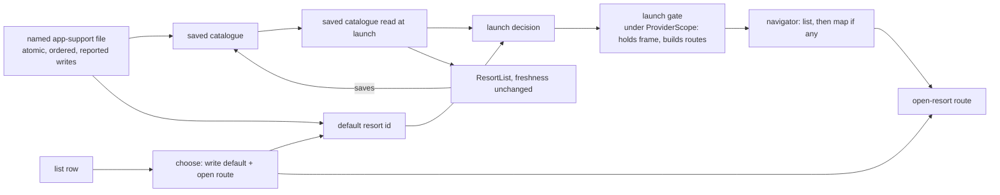

# F4 Reopen the last resort: design

Spec: `specs/F4-reopen-last-resort.md`.

## 1. Reviewer summary

**Basis (C).** These concepts:

- A **named app-support text file**, generalised from `CatalogueStore`. It owns the atomic write, runs writes in call order, and reports failed writes. It has two instances: the saved catalogue and the **default resort** (a catalogue id).
- One **saved catalogue read at launch**, shared by the launch decision and the resort list.
- The **launch decision**: default id × that read → a resort or nothing.
- A **`choose(resort)`** beside the shared **open-resort route**: it writes the default and pushes the map.

Rejected:

- **A**, a separate default-resort owner with its own write chain and reporting, and a second catalogue read at launch. It gives two homes each for write ordering and failure reporting. The name-from-the-launch-read AC would then depend on an unprotected step order in `ResortList._launch`.
- **B**, the `ResortList` notifier also owning the choice. That gives one owner to list freshness and the skier's choice, and F3 favourites would be drawn in too. The app's first route would also wait on the list notifier.

**Decisions**

1. **The default resort is one app-support file holding the raw id**, compared exactly with no trimming. *(grilling)*
   - Rejected: drift at migration 1 (build_runner and native SQLite for one value, and a database open before the first frame); shared_preferences (a third storage mechanism, with no atomic write).
   - **D5 is amended:** single-value user state is an atomically written app-support file. The first multi-value state (F3) chooses between an enveloped JSON file read through `openDocument` and drift.
2. **The named file owns atomicity, write order and failure reporting.** Pending/flush/rename moves out of `CatalogueStore`, and the write chain and reporting move out of `ResortList`. It catches *any* error, because the default write isn't awaited, and reports it through `recordRun` and `FlutterError.reportError`. The previous copy stays.
   - Rejected: two copies of the chain and reporting; catching only `FileSystemException`, which would leave other errors uncaught.
3. **An unknown or unreadable default just doesn't match.** The file is never validated and never cleared. A missing or corrupt file, an id not in the saved list, or an unreadable saved list all lead to the list showing.
   - Rejected: validating the format, or clearing a bad file (the spec says skip).
4. **The launch gate is a `ConsumerStatefulWidget` under `ProviderScope`**, following `ScratchCleanUp`, inside `SkimapperApp`. It does three things:
   - It defers Flutter's first frame, so the native launch screen stays up.
   - It builds no navigator until the decision resolves, so the list can't flash. Both mechanisms back "no flash".
   - It releases the frame in a `finally` and on dispose, and records the decision's outcome in the debug run record.

   `SkimapperApp` and F1's ProviderScope placement are unchanged.
   - Rejected: the hold in `_SkimapperAppState` (above the scope, so it can't read providers); an overrides parameter on `SkimapperApp`; a blank frame drawn while deciding.
5. **The reopened map sits on the list.** Launch starts the navigator with two routes, the list and then the map, built by the shared open-resort route.
   - Rejected: show the list, then push the map.
6. **Choosing is `choose(resort)` beside the open-resort route.** It pushes at once and writes the default without awaiting. The list row calls it, and a future search would too.
   - Rejected: the logic inside the list row's private `_open`.
7. **`ScratchFolders` closes the launch clean-up race.** A reopened map now opens right after launch, so `newFolder` waits for any in-flight `clearAll`.
   - Rejected: the launch gate waiting for the clean-up (couples unrelated things).

**Guiding principles**

- Only `choose` writes the default. Launch, Back and the reopened map never write or clear it.
- "Can the default reopen" is answered only by a lookup by id in the saved catalogue read at launch. The network never takes part in the launch decision.
- The reopened map is the map opened from the list: same route, and the same `Resort` value from the launch read. It has no launch-only state.
- Every launch outcome releases the first frame: match, no match, throw, or disposed before resolving. A failed decision shows the list and is recorded.
- The named file's owner is the only code that touches its file. E2E helpers go through it, never a path.
- Every E2E chain states its default-resort precondition at its first step (`clearPackageData` is off, D7).

**Risks and blast radius.** App-only. All 12 Patrol tests gain a "no default" precondition (in `offline_relaunch`, step 1 of 2 clears it). `main_test`, `home_screen_test` and `resort_list_view_test` gain overrides. `ResortList` drops its save code and takes the launch read as an input.

**Technical unknowns**

1. Whether a first-frame deferral behaves in widget tests and in Patrol on both platforms. Slice 1 proves it on day one. The fallback is a blank frame drawn while deciding.
2. E2E can't observe a cold-start frame: a Patrol relaunch re-pumps the app inside a running engine. So the weakest AC, "without the resort list showing first", rests on widget tests (§ 5).

**Accepted risk: crash loop.** If the default resort's map crashes natively (MapLibre faults the app can't see, D8/F5), it crashes on every launch. The skier's escapes are going offline (the map fails to load, then Back) or reinstalling. This is accepted at this scale and revisited at public release, and it is captured as backlog **F23**.
- Rejected: writing the default only after the map first renders (breaks the spec's "whether or not the map loads"); a "previous reopen didn't render" guard (a third piece of state, for an unobserved failure).

**Spec requirement driving disproportionate complexity.** None beyond the spec's lever (the check against the saved list, which the spec keeps). Basis C removes its double-read cost.

**Not changing.**
- The map screen and its open, the endpoint, every screen's look, and resuming from the background.
- `ResortList`'s freshness rules. Its quiet launch fetch now starts after two small local reads, which is negligible.

**Gate rulings**
- *Grilling:* the store is an app-support file (decision 1, amending D5); the UI sketch is waived (no screen or layout changes).
- *Gate:*
  - The crash loop is accepted explicitly and revisited at public release, with backlog item F23 captured (user).
  - Basis C over A and B (auto).
  - Decisions 1–7 as recommended (auto).
  - The test-strategy changes in § 5 (auto).
  - The guiding principles, risks and unknowns, register additions, § 7 tweaks, definition delta and "not changing" as stated (auto).
  - Exact renames (`CatalogueStore`, its provider) left to `/implement` (auto).

## 2. Basis and decomposition

**C (chosen): a deeper named file, a shared launch read, a launch decision, and choose beside the open route.**

How the ACs fall out:
- **Reopen on launch** and **pick another**: `choose` writes, and launch reads.
- **Back keeps the default**: launch never writes.
- **No default**, **not in the saved list** and **no readable list**: in all three the lookup misses.
- **Map can't load at launch**: the unchanged map screen sits on top of the list.

*What it makes hard:* `ResortList` changes a little. It drops `_saves`/`_write` and takes the launch read as an input instead of reading the file itself. The weakest AC is "without the resort list showing first", which only widget tests can see.

**A: a separate default-resort owner, with a second catalogue read at launch.**
*What it makes hard:* two homes for write ordering and failure reporting. Two reads that must agree, held together only by step order inside `ResortList._launch`.

**B: `ResortList` also owns the choice and exposes its launch read.**
*What it makes hard:* one owner for freshness and choice, which pulls F3 into the same notifier. The first route waits on the list notifier, though only on its saved read, not on its fetch.

**Decomposition.**

**New:**
- the launch read
- the launch decision
- the launch gate
- `choose` and the open-resort route, which moves out of `resort_list_view.dart`
- the default-resort file instance

**Changed:**
- `CatalogueStore`, which becomes the named file
- `ResortList`, which takes the launch read and drops its save code
- `SkimapperApp`, which wraps the gate
- `ScratchFolders.newFolder`, which waits for `clearAll`

**Seams:**
- The launch decision is a pure function of (default id, launch read). Its tests hang off it.
- The named file is the only toucher of its file.
- The open-resort route is the only way app code pushes a map screen. `resort_map_screen_test` pushes directly, and that is fine.
- The launch gate is the only holder of the first frame.

## 2a. UI sketch

Waived at grilling: no screen or layout changes. Launch either shows the list as today, or shows the existing map screen with the list behind Back. The native launch screen stays up while the app decides.

## 3. Single-home register

| Business rule | Single home | Paths that consume it |
|---|---|---|
| Choosing a resort means opening its map from the list, and sets the default | `choose(resort)` beside the open-resort route | list row tap. Launch, Back and the reopened map never call it. `resort_list_view_test`'s Paradiski tap needs a default-file override |
| The default reopens only if its id is in the saved list read at launch, and the name comes from that list | launch decision (lookup by id in `Catalogue`) | launch gate's initial routes |
| The saved list read at launch: a copy that can't be read counts as nothing saved | launch read over the named file + `openCatalogue` | launch decision (new consumer); `ResortList._launch` (now consumes it instead of its own read) |
| A failed write leaves the previous copy whole; writes land in call order; a failed write is reported in the debug run record, not shown | named app-support file | catalogue save (`ResortList`); default write (`choose`); E2E helpers `patrol_test/support/saved_catalogue.dart` and the new default-resort helpers (read, write, `clear()`); `catalogue_store_test`; `resort_list_view_test`'s slow-store subclasses |
| Opening a resort's map | open-resort route | `choose`; launch gate's initial routes. App code only: `resort_map_screen_test` pushes directly |
| Every launch outcome releases the first frame; a failed decision shows the list and is recorded | launch gate | `SkimapperApp` (and so every E2E test, `main_test` and `home_screen_test`, which run the real gate) |
| Launch never waits on the network | the launch decision reads only the two local files | launch gate |
| No resort data is kept, and a live open's folder is never deleted | `ScratchFolders` (existing) | `ScratchCleanUp` at launch; every map open, including the reopened one (new timing) |

## 4. Data / schema shape

One new app-support file holding the chosen resort's catalogue id as UTF-8 text, compared exactly with no trimming. It has no envelope and no version (decision 1 says when that changes). Nothing is backfilled: no file means no default. Atomic rename means a crash mid-write leaves the previous default or none.

## 5. Test strategy

| Behaviour | Outer test |
|---|---|
| Default reopens on launch | E2E chain in `catalogue_serving` (Paradiski): open, relaunch, and see Paradiski's map. Asserts the launch-decision run-record line |
| Back goes to the list, and the default stays | the same chain continues: Back shows the list, and the next relaunch shows Paradiski again |
| Picking another replaces it | E2E chain over a Paradiski default: open Espace San Bernardo (not Les 3 Vallées, the hash-mismatch fixture there), relaunch, and see Espace San Bernardo's map |
| No default | the existing 12 Patrol tests, each with an explicit "no default" precondition |
| Default not in the saved list | E2E chain: seed an unknown id and a saved list, and see the list. A later launch once the id is in the list reopens it |
| No readable saved list | E2E: seed a default and a corrupt catalogue file, then see today's nothing-saved list. The default file is unchanged |
| Map can't load at launch | E2E in `endpoint_scripted`: a default and a saved list, endpoint stopped. See "Couldn't load map" with Retry, Back shows the saved list, and the default is unchanged |
| No flash of the list, and the frame released on every outcome | widget tests on the launch gate with in-memory file fakes (real `dart:io` hangs under FakeAsync). One per outcome (match, no match, throw, disposed before resolving): nothing from the list is built before resolving, and the binding sends frames again after `resetFirstFrameSent`. If that check proves unreliable, a counted defer/release seam |
| Failed write keeps the previous copy and is recorded; writes land in call order | unit tests of the named file (no user-visible surface, as for F1's save failure) |
| A live open's folder survives the launch clean-up | unit test of `ScratchFolders` |

**E2E chain naming (extends D7).** A chain of any length is named `<unique chain prefix> <n> of <m>`, so the iOS runner's name order keeps each chain together and in step order. Its first step sets every precondition, including the default. Helpers set and clear the default and the saved catalogue through the named-file owner. There's no database, so the real-database note doesn't apply.

## 5a. Failure posture

Every path is local and in the foreground. A failed decision shows the list and is recorded. A failed write is recorded and keeps the previous copy. Nothing is invisible, because the launch gate always releases the frame and records the outcome. The write is atomic, so nothing is irreversible from the data's point of view.

Accepted at this scale:
- a launch read that hangs without throwing holds the launch screen (the spec sets no time budget).
- the native crash loop (§ 1, backlog F23).

## 6. Definition delta

- `docs/definitions/resorts.md`: tapping a row also makes that resort the default. New "Default resort" section: launch behaviour, skip-not-clear, and how the default is stored.
- `docs/definitions/resort-map.md`, § Opening and leaving: the map can open at launch on the default resort, with the list beneath it. Back returns to the list either way.
- `docs/DECISIONS.md`:
  - amend D5 (decision 1).
  - extend D7 with the chain-naming rule.
  - new F4 entry: the launch gate (frame hold plus no navigator until decided, under the scope), the two-route stack, the shared launch read, the named file owning ordered and reported writes, and the accepted crash loop.
- `docs/ARCHITECTURE.md`: the device-storage line follows D5's amendment, and "Built so far" mentions the default resort.

## 7. First slices (indicative)

- **Walking skeleton:** a skier opens Paradiski's map from the list, relaunches, and sees Paradiski's map with the list behind Back. This proves the frame hold, the default file, the launch decision and the two-route stack on both platforms. It adds the "no default" precondition to the existing E2E tests.
- A skier on the reopened Paradiski map goes back, sees the list, relaunches, and sees Paradiski's map again.
- A skier who opens Espace San Bernardo over a Paradiski default relaunches and sees Espace San Bernardo's map.
- A skier whose default isn't in the saved list, or who has no readable saved list, launches and sees the list as today.

Surface-less work rides inside these slices, with unit or widget tests, because none of it changes what the skier sees: write ordering, failed-write reporting, frame release on throw or dispose, and the scratch clean-up wait.

## Slices

- [x] 1 A skier opens Paradiski's map from the list, relaunches, and sees Paradiski's map; Back shows the list, and the next relaunch shows Paradiski again (E2E chain in `catalogue_serving`)
- [x] 2 A skier who opens Espace San Bernardo over a Paradiski default relaunches and sees Espace San Bernardo's map (E2E chain in `catalogue_serving`)
- [x] 3 A skier whose default isn't in the saved list, or who has no readable saved list, launches and sees the list as today; once the default is back in the saved list a later launch reopens it (E2E in `endpoint_scripted`)
- [ ] 4 A skier whose default resort's map can't load at launch sees "Couldn't load map" with Retry, and Back shows the saved list (E2E in `endpoint_scripted`)

## Decisions taken during implement

- The design's first two indicative slices (reopen; Back keeps the default) are one slice: Back adds no code, only a third step to the same E2E chain (`reopen 1..3 of 3`).
- `CatalogueStore` is renamed `AppSupportFile` (`lib/storage/app_support_file.dart`), named per file; `savedCatalogueFile()` and `defaultResortFile()` own the two file names, and the E2E helpers go through them.
- The default-resort file is `default-resort` in app support; `chooseResort`, `resortMapRoute` and `defaultResortFileProvider` live in `lib/resorts/choose_resort.dart`; the shared launch read is `savedCatalogueAtLaunchProvider` beside the other resort-list providers.
- `MaterialApp` takes the home route from `onGenerateRoute`, because `home` and `onGenerateInitialRoutes` are exclusive and without `home`/`routes`/`onGenerateRoute` it builds no Navigator.
- `ScratchFolders.newFolder` waits for the launch clean-up with its error dropped: otherwise one failed clean-up would fail every later map open (its own test).
- Write ordering is tested once, at `AppSupportFile`. `resort_list_view_test`'s slow-first-save test and subclass are removed because `ResortList` no longer orders writes.
- The launch read and the launch decision are never retried (`retry: (_, _) => null`). Riverpod 3 retries failed providers by default, which would hold the launch screen instead of failing visibly to the list.
- The launch decision's run-record lines are `launch: reopens <id>`, `launch: shows the list` and `launch: decision failed, shows the list: <error>`; E2E reads them by wrapping `debugPrint` around `pumpWidget` (`launchApp`).

## Resume

Slices 1–2 are closed (db66f0a, 219f203; logs in `test-results/tdd/F4/`). Slice 3 is in progress: *a skier whose default isn't in the saved list, or who has no readable saved list, launches and sees the list as today; once the default is back in the saved list a later launch reopens it*. Its new code is the gate's handling of a failed decision (show the list, record it, release the frame). The decision's lookup already misses safely (slice 1, behaviour 11), so the E2E chains in `endpoint_scripted` lead this slice. The extra-area catalogue entry has id `extra-area`. Remaining after slice 3: slice 4 (map can't load at launch, plus releasing the frame on dispose) and the `catalogue_unknown_version` group run.
