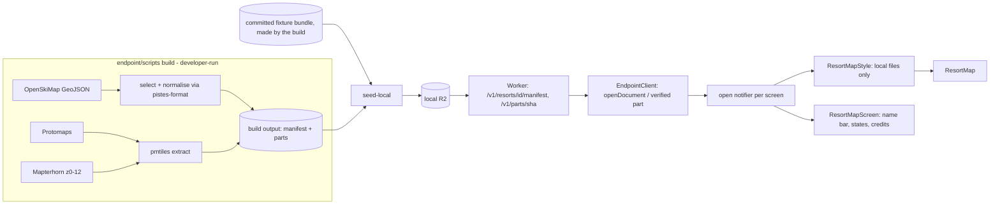

# F5 Resort map: design

Spec: [F5-resort-map.md](F5-resort-map.md). UI sketch: [F5-resort-map-ui.html](F5-resort-map-ui.html)
(Artifact: https://claude.ai/artifact/2ef2qpU51h4w1G21KvC5Uk).

## 1. Reviewer summary

**Licence (D2) confirmed.** openskidata.org says the exports are "free to use, including
commercially", with share-alike for a modified version that is distributed (ODbL), so D2's raw-OSM
fallback is not needed. OpenSkiMap groups runs into ski areas using Skimap.org records, so the
credits add **Skimap.org**. The spec's credits AC string becomes "© OpenStreetMap contributors ·
OpenSkiMap · Skimap.org · Protomaps · Mapterhorn".

**Basis.** A resort is **one enveloped manifest that pins three parts by hash**:

- *pistes*: runs and lifts as plain GeoJSON, keeping only name, difficulty and lift type;
- *basemap*: vector PMTiles;
- *terrain*: Terrarium PMTiles.

The app checks the manifest through `openDocument` and fetches and verifies each part as an opaque
file. **Only the map style reads what is inside a part.** The manifest's `schemaVersion` versions
every part's format.

Rejected: an enveloped *data document* parsed on the device (§ 2, candidate B). It would mean a
several-MB parse and re-write on every open and two version checks per bundle. It would also put
derived files next to the verified parts, which D5 rejects.

**Decisions**

1. **Catalogue entries gain a required slug `id` (`^[a-z0-9-]+$`, e.g. `paradiski`), and
   `schemaVersion` stays at 1.**
   - `endpoint/catalogue/curated.json` is the one home of the ids. The build and `seed-local` fail
     if the resort-areas file names a different set.
   - `Catalogue.parse` checks the format and rejects duplicate ids. An entry with no valid id fails
     the whole list, as any malformed entry does today.
   - A saved copy without ids counts as nothing saved, and a fetch follows (D5).
   - The catalogue's "current manifest version" field is deferred to F16.
   - Rejected: using names as ids (F20 can rename them, and accents would end up in URLs); bumping
     the schema (nothing is deployed, C10).
2. **Bundle shape, and the restated principle.**
   - **Manifest:** kind `resort-manifest`, v1, at `GET /v1/resorts/{id}/manifest`. It carries
     `bounds`, `credits` and `parts`, each part with a role, sha256 and size.
   - **Parts:** served at `GET /v1/parts/{sha256}`. The build publishes the parts before the
     manifest.
   - **ARCHITECTURE and D8 are restated:** "Documents (mutable *latest* keys) are enveloped and
     checked by `openDocument`. Parts (content-addressed, pinned by a manifest) are never enveloped,
     whatever their encoding, and the pinning manifest's `schemaVersion` versions their format."
     F11's routing graph and F6's status key map will be parts under this rule.
   - **When the manifest's version bumps:** for a change to the Protomaps tile schema, and when
     F6/F7 add stable feature ids. Pistes carries no feature ids yet, because OpenSkiMap's change
     every build.
   - Rejected: candidate B; runs and lifts as vector tiles (tippecanoe in the build; kept as the
     performance fallback).
3. **The build selects and the app presents.**
   - **The build** owns membership (a curated list of stable ski-area source ids per resort id),
     downhill-only runs, operating-only runs and lifts, the cut-down properties, 2D coordinates,
     `bounds` and `credits`.
   - **The app's style table** owns difficulty → run style and lift type → drag or aerial
     (`drag_lift` is drag; any other or missing type is aerial).
   - **Part formats have one home:** a pistes-format module in `endpoint/`, which the build's
     normaliser writes through. **The fixture pistes file is the normaliser's output** over the
     sample used by the build's Vitest tests, never hand-written, and a Vitest test keeps the
     committed file in step.
   - Rejected: the app also filtering (two homes for one rule).
4. **Credits come from the manifest.** `AttributionLine` renders the manifest's list on the map
   screen only, and the ODbL credit duty moves to the build. Rejected: an app constant, which could
   drift from the sources actually used.
5. **Part fetches live in `EndpointClient`.**
   - They share its transport-failure classifier (connection, non-2xx, timeout) and its `Failed`.
     Only the success branch differs: a verified file instead of a document.
   - Each part fetch runs in its own `Isolate.run`, streams to the open's scratch folder, and hashes
     as it streams (`crypto` package).
   - These count as *failed*: a wrong size or hash, an incomplete body, or more than
     `ENDPOINT_TIMEOUT_MS` with no bytes arriving. The timeout is an inactivity timeout with no
     total cap.
   - The manifest is fetched first, then the three parts in parallel. Downloads already in flight
     when the screen goes are left to finish and their result is discarded, which is accepted at
     this scale.
6. **One open per screen instance.**
   - The notifier is created per pushed route, not cached by resort id, so a reopen always fetches.
   - Each fetch (the open itself, or Retry) gets a generation number and its own scratch folder. An
     answer is applied only if it belongs to the newest fetch and the screen still exists.
   - **Nothing kept:** the scratch root is cleared at app launch. Each new open deletes the folders
     of opens whose screens are gone, never a live one.
   - Rejected: a widget-local `FutureBuilder`; clearing the whole root on every open (it could
     delete files a map is still tearing down from).
   - The generation logic deliberately repeats F1's: one small notifier each, with no shared helper
     yet.
7. **Style, map widget and screen.**
   - **One style builder:** `resort_map_style.dart` replaces `local_map_style.dart` and keeps its
     every-URL-is-`file://` test.
   - **One map widget:** `ResortMap` replaces `FixtureMap` as the only place a `MapLibreMap` is
     built, and it installs the start-up-safe map platform (D4).
   - **Background:** Protomaps' grayscale flavour, generated once from `@protomaps/basemaps` and
     committed as an app asset, with no points of interest or icons. Town, village and peak names
     are kept, in grey.
   - **Hillshade:** from the terrain source, over land cover and under roads and labels.
   - **Glyphs:** bundled Noto Sans PBFs, installed to app support through the existing install
     pattern and referenced by `file://`. A failed install counts as *couldn't load*.
   - **Map errors:** MapLibre style and source errors go to the debug run record.
   - **Controls:** tilt off, rotate on, a compass that shows only when rotated and resets to north,
     and MapLibre's logo and attribution button off.
   - **Lifts:** a dark core inside a white casing, which no run has. Aerial lifts are solid with
     station dots; drag lifts are dotted.
   - **Screen:**
     - a pushed route with an app-bar name bar (the resort name in the primary colour, and back) in
       every state;
     - the map filling the body;
     - the credits in a bottom bar below the map, shown only with a map;
     - loading, "Couldn't load map" and "Update SkiMapper to see this map" as full-area states;
     - list rows gain a trailing chevron.
   - **Retired:**
     - `fixture_map.dart`, `fixture_feature.dart`, `bundled_basemap.dart` (its pattern is reused
       for glyphs), `assets/map/fixture.pmtiles` and `tools/fixtures/make_fixture_pmtiles.py`,
       with their tests;
     - the DECISIONS bullet about the fixture tile;
     - the home screen's credits. `attribution_test` and the snackbar-over-credits check move to
       the map screen.
   - Rejected: remote glyphs (they break "no style references a remote URL"); sprites.

**Guiding principles**

- **No remote URL in any style.** Every path the map reads is a local file the app verified or
  installed.
- **A part is used only once its size and hash match the manifest.** Every outcome for a document
  or a part is classified in `EndpointClient`/`openDocument` only.
- **The build selects, the app presents.** Membership, status, use, bounds and credits belong to
  the build. Colours, dashes, casing and labels belong to `resort_map_style.dart`. Part formats
  belong to the pistes-format module.
- **The open notifier is the only writer** of what the map screen shows.
- **Fixture and real data take the same path:** a bundle → `seed-local` → Worker → app. There is no
  silent fallback.
  - dev-app serves the fixture unless `RESORT_DATA=built` is set.
  - With `RESORT_DATA=built`, it fails naming every curated resort that has no build output.
- **No resort data persists** between opens or launches. Glyphs are an app asset, not resort data.

**Risks / blast radius.**

- **Changes:**
  - the home screen (fixture retired, credits moved, rows tappable);
  - the catalogue shape;
  - two Worker routes;
  - `seed-local`, dev-app and E2E seeding;
  - a new developer-run build;
  - new app assets.
- **Nothing irreversible:** nothing persists on the device.
- **Unknowns proven in slice 1 on iOS and Android:**
  - GeoJSON from `file://`;
  - `file://` glyphs;
  - `pmtiles://file://` as a `raster-dem` source with hillshade;
  - iOS decoding Mapterhorn's WebP tiles. The fallback is for the build to re-encode the terrain to
    PNG.
- **Performance:** panning GeoJSON over Les 3 Vallées is checked in slice 2, before any style work.
  The fallback is vector tiles for runs and lifts.

**Spec requirements driving disproportionate complexity.**

- **The three-source build:** weighed at the spec, and all three resorts were kept.
- **The fixture's basemap and terrain:** the fixture uses a **tiny real cut made by the same build**
  (a few km² at low zoom, a few hundred KB of ODbL data and open terrain), not synthetic tiles.
  Accepted at the gate.

**Not changing.** The resort list's freshness, saving, ordering and failure states; `openDocument`'s
three outcomes; the envelope's shape; D3 status; drift (there is none yet); dark mode.

**Questions the gate ruled on**

- **Grilling** (all six recommendations agreed):
  1. Skimap.org is added to the credits.
  2. `drag_lift` uses the drag style.
  3. The part timeout is an inactivity timeout on `ENDPOINT_TIMEOUT_MS`.
  4. The build is Node TypeScript in `endpoint/scripts/`, using the `pmtiles` command-line tool.
  5. dev-app serves the fixture by default, and the build output with `RESORT_DATA=built`.
  6. Terrain is cut to zoom 12 from Mapterhorn's planet file.
- **Basis:** A, the manifest plus opaque pinned parts (user).
- **Decision 2:** the reworded principle, with the ARCHITECTURE and D8 amendments (user).
- **Decisions 1, 3, 4 and 5 as written** (coordinator). The user confirmed the part-format home and
  the fixture as normaliser output.
- **Decision 6 as written** (coordinator). The user confirmed the per-screen open and the scratch
  folder rule.
- **Decision 7:**
  - the non-visual parts as written (coordinator);
  - the visible parts accepted with the sketch (user): background without points of interest, grey
    town and peak names, layer order, controls, compass only when rotated, MapLibre's logo and
    attribution off.
- **Sketch:** lift casing (aerial solid, drag dotted), the credits bar below the map and only with
  a map, town and peak names kept, the row chevron, the name bar and back in every state, and the
  update wording (user).
- **E2E plan as written** (coordinator). The user confirmed the seeding register rows and the D7
  delta.
- **Slice order as reordered** (the user confirmed the reorder).
- **Fixture lever:** a tiny real cut from the build (user).
- **Reviews:** every architecture-lens and design-skeptic finding is accepted as folded in, with all
  six 🟠 confirmed (user).

## 2. Basis, then decomposition

**Candidate A (chosen): manifest plus opaque pinned parts.**

- **Concepts:**
  - catalogue `id`;
  - the `resort-manifest` document;
  - a part: a hash-pinned file whose format the manifest versions;
  - the open: a per-screen notifier;
  - `ResortMapStyle`, which owns the presentation rules and the local paths;
  - the pistes-format module;
  - the build, which owns selection and publishing.
- **How the ACs fall out:**
  - *Framing* is the manifest's bounds fed to the camera.
  - *Colours, labels and lift styles* are style layers over the pistes source.
  - *Muted and shaded* are the grayscale layers plus hillshade.
  - *Credits* come from the manifest.
  - *Back* pops the route.
  - *Couldn't load* is any *failed* outcome. *Hash mismatch* is part verification. *Update the app*
    is the manifest's *incompatible* outcome.
  - *Only operating, downhill* is the build's selection.
- **What it makes hard:**
  - **The AC it gives up.** A part whose hash matches but that MapLibre can't read (a malformed
    pistes file, or an undecodable tile) draws nothing, silently, where the spec's "not understood"
    wants "Couldn't load map". This is mitigated: such a part can only come from our own build, and
    the build writes the pistes file through the format module. MapLibre errors go to the run
    record, and slice 1 proves WebP decoding.
  - **Later parsing.** F7 and F11 will parse pistes in Dart later, with no envelope of its own.
  - **The documents vs parts principle** needs restating (decision 2).

**Candidate B: enveloped data document.** A's concepts, plus a `resort-data` envelope opened through
`openDocument` with a Dart parse, whose runs and lifts are re-written to scratch files for the
style.

- It adds "update the app" from the data part.
- **What it makes hard:**
  - a parse and re-write of several MB on every open;
  - two version checks per bundle;
  - a Dart run and lift model arriving before anything uses it;
  - derived files next to verified parts, against D5.

**Why A.** It carries every AC with the fewest concepts. It extends the existing envelope and
`EndpointClient` with one more degree of freedom (a pinned part) instead of adding a parallel
reader. It also matches D5's "a directory holding its manifest and parts", which F16 can keep.

**Seams.**

- **Build ↔ R2:** `artefact-layout.ts`.
- **Worker ↔ app:** HTTP, the envelope, and hash-pinned bytes.
- **`EndpointClient` ↔ open:** outcomes only. The open never sees HTTP.
- **Open ↔ screen:** one state value.
- **Style ↔ MapLibre:** a style string of local paths. The layer ids are what the E2E
  rendered-feature queries hang off.
- **Style table ↔ layers:** one table generates every run and lift layer.
- **Build ↔ app formats:** the pistes-format module on the build side, and the style table's value
  lists on the app side, pinned together by the fixture the normaliser outputs.

## 2a. UI sketch

https://claude.ai/artifact/2ef2qpU51h4w1G21KvC5Uk ([F5-resort-map-ui.html](F5-resort-map-ui.html)):

1. List rows with a chevron.
2. The loaded map screen.
3. "Couldn't load map" under the name bar.

Every UI choice with consequences is recorded in decision 7.

## 3. Single-home register

| Business rule | Single home | Paths that consume it |
|---|---|---|
| Which runs and lifts belong to a resort | build's curated resort-areas file (`endpoint/catalogue/`, stable ski-area source ids per resort id) + the build's selection function | build only; the app draws what pistes holds |
| Only operating runs and lifts, only downhill runs | the build's selection function | build (pistes of every resort, fixture included) |
| Pistes format (feature kind, property names, difficulty and lift-type values) | pistes-format module in `endpoint/` | build normaliser (real and fixture output); app style table (consumes the values); a Vitest test keeps the committed fixture equal to normaliser output |
| Basemap tile schema assumed by the background layers | the Protomaps version pinned in the build, recorded with the committed basemap layers asset; a change bumps the manifest version | build cut; `resort_map_style.dart` |
| "The whole resort" framing | build computes `bounds` into the manifest | open state → `ResortMap` camera |
| Difficulty → run style (green, blue, red, black, dashed dark, grey; faint area fill) | one table in `app/lib/map/resort_map_style.dart` | run line, area and label layers |
| Lift type → drag or aerial (`drag_lift` is drag) | same table | lift casing, core, station and label layers |
| "Muted" and "shaded" | `resort_map_style.dart` + committed grayscale basemap layers asset | every resort's style |
| Credits | build writes the manifest's `credits`; `AttributionLine` renders | map screen only (**leaves** the home screen) |
| Accepted kinds and schema versions | `_acceptedSchemaVersions` in `contract_envelope.dart` (**gains** `resort-manifest: 1`) | catalogue fetch, saved catalogue, manifest fetch |
| Part integrity (size + sha256) | `EndpointClient` part fetch | pistes, basemap and terrain |
| Fetch outcome classification | `EndpointClient` (shared transport classifier, one `Failed`) + `openDocument` | catalogue, manifest, parts |
| R2 key layout | `endpoint/src/artefact-layout.ts` | Worker routes, `seed-local`, build publishing |
| Resort ids | `endpoint/catalogue/curated.json`; format and uniqueness checked in `Catalogue.parse` | list row tap → open → manifest route; resort-areas file; build output and seeding keyed by id |
| Which bundle is seeded under which id (fixture, build output, broken E2E variants) | `endpoint/scripts/seed-local.ts` options | `tools/lib/endpoint.sh` seed function, `tools/e2e` `prepare_endpoint` and `serve_catalogue`, `tools/dev-app` (`RESORT_DATA`) |
| No remote URL in a style | `resort_map_style.dart` (the only style builder) | `ResortMap` (the only `MapLibreMap` building point) |
| Start-up-safe map teardown | `start_up_safe_map_platform.dart`, installed by `ResortMap` | every map |
| Only the newest answer counts | the open notifier's apply step | open, Retry |
| No resort data kept between opens or launches | the open notifier's scratch-folder rule (decision 6) | every open, app launch |
| Endpoint timeout value | `tools/dev.env` `ENDPOINT_TIMEOUT_MS` | catalogue and manifest (whole request), parts (inactivity) |

## 4. Data / schema shape

- **Catalogue entries** gain a required slug `id`. `curated.json` and `seed-local`'s extra-area
  variant get ids. There's no deployed data to migrate, and a saved copy without ids is refetched.
- **Manifest:** `bounds` (west, south, east, north), `credits` (a list of strings), and `parts`
  (role `pistes`, `basemap` or `terrain`; sha256; size). Enveloped, schema 1.
- **Pistes:** one GeoJSON FeatureCollection.
  - Each feature has its kind (`run` or `lift`) and a name or null.
  - Runs add a difficulty or null, and are LineStrings or Polygons.
  - Lifts add a lift type, and are LineStrings.
  - Coordinates are 2D.
- **R2 keys:** `latest/resorts/<id>/manifest.json` and `parts/<sha256>`.
- **Risk:** none on the device. In R2, parts are immutable and C10/F20 own clean-up. The build
  output and its downloads are gitignored; the fixture bundle is committed.

## 5. Test strategy

Each behaviour is listed with its outermost test.

- **E2E seeding.** `catalogue_serving` seeds three bundles:
  - the good fixture under Paradiski;
  - a hash-mismatch bundle under Les 3 Vallées;
  - a v999 manifest under Espace San Bernardo.

  That gives one endpoint state and no extra group. `endpoint_scripted`'s `serve-catalogue curated`
  seeds the same bundles. Seeding is atomic before start, so the existing catalogue probe is
  enough.
- **Opening a resort shows its map, named and framed** → E2E. The test taps Paradiski and expects
  the name bar. After the style loads, a rendered-features query over the viewport returns every
  fixture run and lift. On Android it then cuts Wi-Fi and cellular, moves the camera and queries
  again, which keeps D4's "renders with networking off" proof.
- **Run colours, dashes, grey, area fill, drag vs aerial lifts, labels when zoomed in** → E2E. Each
  fixture feature is found in its class's layer, and label layers return the names after zooming in.
  Unit tests on `resort_map_style.dart` cover the table, the generated filters and paint,
  `drag_lift` → drag, and every URL being `file://`.
- **Only operating, downhill; nordic, ski-touring and sledging not drawn** → Vitest on the build's
  selection over the OpenSkiMap-shaped sample, including a proposed run and a disused lift. This is
  the outer test because the rule has no app surface.
- **The fixture pistes file matches the normaliser's output** → Vitest.
- **Muted and shaded** → style unit test (hillshade present, grayscale layers, no POI layers). How
  it looks is judged in the demo pack.
- **Credits** → E2E: the manifest's credits show on the map screen.
- **Back returns to the list alone** → E2E: no map and no credits.
- **Couldn't load + Retry** → E2E (`endpoint_scripted`): stop the endpoint, open, see the message;
  serve again, tap Retry, see the map.
- **Hash mismatch** → E2E (Les 3 Vallées).
- **Incomplete part** → `EndpointClient` test with a fake HTTP client. It's unit-only because the
  Worker can't be made to cut a body short.
- **Update the app** → E2E (Espace San Bernardo).
- **Loading state, and interaction settings** (no tilt, rotate, compass, taps do nothing) → widget
  tests on the screen and the `MapLibreMap` settings. These are platform-drawn settings, so there is
  no meaningful E2E for them.
- **Only the newest answer counts** (back then another resort, Retry twice) → widget test with a
  fake client holding answers on completers. Network answer order can't be scripted in E2E.
- **Worker routes** (manifest, part bytes, unknown id or bad hash → 404) → Miniflare integration
  tests.
- **Build** (bounds, credits, manifest, publishing order and keys) → Vitest. The real runs, the
  performance NFR and the look are captured in the demo pack.

No path needs a real database, because none exists.

## 5a. Failure posture

The request path fails fast and visibly:

- every fetch, verification or glyph-install failure shows "Couldn't load map" with Retry;
- its cause goes in the debug run record;
- MapLibre style and source errors are logged there too.

The hand-run build fails fast with one error naming the step, source or resort. There's no hidden
path, nothing irreversible, and no authorisation.

Accepted as they are:

- a part that matches its hash but can't be read draws nothing (decision 2 and § 2);
- a failed scratch clean-up is only logged;
- downloads already in flight when the screen goes run to completion and are discarded.

## 6. Definition delta

- **New area doc `docs/definitions/resort-map.md`:**
  - opening from the list; the name bar and back;
  - framing; what is drawn and how (run, lift and background styles); labels;
  - interaction (pan, zoom, rotate, the compass shown only when rotated, no tilt, taps do nothing);
  - credits shown only with a map;
  - the loading and failure states with their wording;
  - per-open fetching, with nothing kept.

  Add it to the README table.
- **`resorts.md`:**
  - rows open the resort's map and show a chevron (this supersedes "don't respond to taps");
  - entries carry an id;
  - the credits line is removed from the bottom bar, and the snackbar note no longer mentions it.
- **ARCHITECTURE:**
  - the documents vs parts principle (decision 2);
  - the part roles become *pistes*, basemap and terrain, with the routing graph and status key map
    as future parts;
  - the developer-run build;
  - "Built so far".
- **DECISIONS:**
  - **D2:** the licence is confirmed, Skimap.org is credited, and the credit duty sits in the build.
  - **D8:** the documents vs parts restatement; a required `id` added at v1, because nothing is
    deployed.
  - **D7:** the bundles seeded in `catalogue_serving`.
  - **D9:** retired.
  - **"Build-time choices":** the fixture-tile bullet is removed.
  - **New F5 entry:** decisions 2, 3, 5, 6 and 7.

## 7. First slices (indicative)

1. **Walking skeleton.** A skier taps "Paradiski" and sees a full-screen map under a "Paradiski" name
   bar: the fixture's one blue run, drawn and labelled, over a grey basemap with hillshade. Every
   file was fetched through the manifest, checked against its hash, and read from local files on
   iOS and Android. The fixture map and its "map:" line are gone.
2. A developer runs the build for Les 3 Vallées and starts the app with `RESORT_DATA=built`. A skier
   taps Les 3 Vallées, sees the whole real resort framed, and pans across it smoothly.
3. A skier opens a resort while the endpoint is down and sees "Couldn't load map". Once it is back,
   they tap Retry and see the map.
4. A skier opens the fixture resort and sees every run difficulty in its colour, drag lifts dotted
   against aerial ones, all named, with the manifest's credits below the map.

## Slices

- [ ] 1. A skier taps "Paradiski" and sees a full-screen map under a "Paradiski" name bar, drawing the fixture's blue run from a pistes part fetched through the manifest and verified against its hash; the fixture map and its "map:" line are gone. *(in progress)*
- [ ] 2. A skier opening Paradiski sees the run labelled over a grey basemap with hillshade: basemap and terrain parts cut by the build, glyphs installed locally, every file read from `file://` on iOS and Android.
- [ ] 3. A developer runs the build for Les 3 Vallées and starts the app with `RESORT_DATA=built`; a skier taps Les 3 Vallées, sees the whole real resort framed, and pans across it smoothly.
- [ ] 4. A skier opens a resort while the endpoint is down and sees "Couldn't load map"; once it is back, they tap Retry and see the map.
- [ ] 5. A skier opens the fixture resort and sees every run difficulty in its colour, drag lifts dotted against aerial ones, all named, with the manifest's credits below the map; back returns to the list alone.
- [ ] 6. A skier opens a resort whose part doesn't match its hash (Les 3 Vallées in E2E) and sees "Couldn't load map".
- [ ] 7. A skier opens a resort whose manifest needs a newer app (Espace San Bernardo in E2E) and sees "Update SkiMapper to see this map".
- [ ] 8. Only the newest answer reaches the screen, nothing is kept between opens or launches, and the map takes no tilt and no taps.

## Decisions taken during implement

